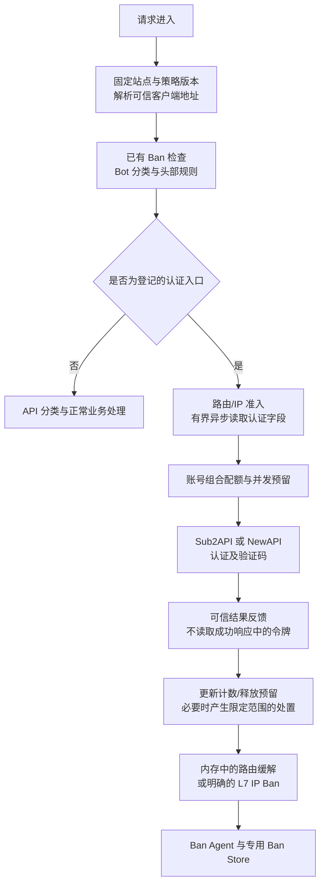

# API 工具链/图片结果、Bot UA 管理与 Sub2API/NewAPI 注册认证防护：调研及设计计划

日期：2026-11-17，America/Los_Angeles。状态：API 编辑/变体分类修复、协议别名/raw 回归和本地媒体处理工具已实现并完成隔离验证；Bot 0.1.0 已实现并验证 UA/CIDR、可信地址、策略编译与作用域；Auth Guard 0.1.0 已有共享准入、Go 协作库与固定版本应用补丁。Bot 种子与弱库均已有消费者。未部署本轮源码到生产。

## 1. 建议与依据

建议先正式合入 `native-api` 的图片编辑/变体识别修复，按[API 工具链与媒体设计](API-PROTOCOL-MEDIA-DESIGN.zh-CN.md)覆盖四种协议的原始传输和显式处理结果，再新增两个可分别启用的原生 C HTTP 模块：`native-bot` 与 `native-auth-guard`。Bot 覆盖国内外可扩展目录、UA/IP 拒绝与严格扫描器策略；Auth Guard 用共同内核与 Sub2API/NewAPI 适配器，增加弱密码、邮箱策略、第一方行为跟踪和建号前拦截。当前八个 HTTP 模块在 Auth Guard 实现后成为九个；Ban Store 仍是 Agent 内部组件。

用户要求的恶意名单具有明确的 OR 语义：**在适用站点/路由内，命中禁用 UA 或禁用 IP/CIDR 中任意一项即可屏蔽**。已确认官方 IP 的搜索服务填写精确来源表，未确认 IP 的保留 UA 分类和站点策略。UA 单独命中不产生可信身份或认证豁免；Censys/FOFA 作为明确要求拒绝的扫描来源单独管理。

两个模块共用小型内部 C 组件，处理可信客户端地址、策略版本、有界计数、一次性请求状态和审计。规则与计数查询使用本机内存，认证请求体沿用有界异步读取；官方 Bot 地址源更新在后台进行。插件不新增 SQLite、Redis、数据库服务或通用键值存储依赖。Sub2API/NewAPI 已有的后端限流继续承担后端保护。

Ban Store 继续只保存 IP 封禁及其必要的回执、期限、解封水位和同步元数据。账号 HMAC、认证计数、跟踪 ID、弱密码字典、邮箱策略、UA 规则和 Bot 地址源不写入 Ban Store。异常注册达到明确规则时，在创建账号之前拒绝并立即加入限定范围的 IP 黑名单；普通字段错误、首次弱密码选择或一次认证失败不自动升级为全局内核封禁。

本轮已准备[可审查的种子数据](security-seeds/README.zh-CN.md)：29 个 Bot 条目与 4 个不可独立识别的搜索服务、17 份官方来源的 3,154 条精确前缀、10,001 条已知常见弱密码的本地匹配摘要及许可。Bot 目录/地址种子已由运行模块的编译工具消费；弱密码种子仍标记 runtime_integrated=false。

### 1.1 本次核对的源码基线

| 对象 | 基线 | 核对范围 |
| --- | --- | --- |
| OpenResty_Plugin | `d4d5609963d31404d4f0a507d234dfd4e89540f3` | 七模块、Ban C API、Agent 决策、Config/Edge/API 阶段及存储边界 |
| Sub2API 当前上游 main | `15871f904056f548dd874a1d069ffc6cdf777b78`，版本同步提交 0.2.22 | auth 路由、请求字段、认证服务、验证码、TOTP、邮件验证码、来源 IP、响应格式、API Key 失败限流 |
| NewAPI 当前上游 main | `669d774976369e986f03b6e24fff1042f6f94832` | API/认证路由、用户名/邮箱身份、口令加密、登录挑战、2FA/Passkey、通用/邮件限流及结果格式 |

两套上游均按本次查询到的固定提交读取源码。本次没有访问线上 Sub2API/NewAPI，因此线上版本、可信代理配置、启用的验证码服务、实例数量及认证流量分布仍需在实施时核实。

### 1.2 现有插件可以复用什么

- Config/Edge 已有站点身份、不可变快照、请求持有版本和路由入口，适合绑定防护策略。
- Sync 0.3.0 已有站点/证书发布、签名加密、准备/应用/回退流程；新的安全策略资源、Bot 地址源和能力协商还需要实现对应合同。
- API 已有异步请求体读取和内部代理跳转，需要与认证检查共用一次读取流程。
- Ban 已有可信检测器上报、固定期限、Agent、只读视图及全节点 L3 同步。
- Ban Store 已有内存与持久化模式，可以继续承接确定的 IP 封禁结果。

需要先处理两个具体接口缺口：

1. 现有 Ban 从真实 Socket 对端取 IP；经过前置代理时，这个地址可能是代理。新模块必须同时保存传输对端与经过可信链解析的客户端地址，并明确 L7 与 L3 使用哪个地址。
2. 现有 `BAN_CC` 直接执行 L3，`BAN_WAF` 也会在重复证据达到阈值后升级。新模块必须采用独立的事件与动作合同，明确 `L7_ONLY` 和范围；不能把 Bot 或认证事件包装成旧的 `waf/cc`。

源码定位：[Ban 地址和上报](https://github.com/PH-OpenResty/OpenResty_Plugin/blob/d4d5609963d31404d4f0a507d234dfd4e89540f3/native-ban/src/ngx_http_scdn_ban_module.c#L160-L260)、[Agent 处置](https://github.com/PH-OpenResty/OpenResty_Plugin/blob/d4d5609963d31404d4f0a507d234dfd4e89540f3/native-ban/agent/engine.cpp#L435-L501)、[Edge 调度](https://github.com/PH-OpenResty/OpenResty_Plugin/blob/d4d5609963d31404d4f0a507d234dfd4e89540f3/native-edge/src/ngx_http_scdn_edge_module.c#L302-L335)。

## 2. 调研结果

### 2.0 已确认的 `native-api` 缺陷与修复范围

`api_ai_path()` 的静态路径表包含 `/v1/images/generations`，缺少 `/v1/images/edits` 和 `/v1/images/variations`。请求仍因 POST 或 `/v1/` 前缀被识别为普通 `api`，通常仍绕过缓存，但不能仅凭路径进入 AI profile，首包等待、请求/响应缓冲、压缩和 AI 统计因此可能不正确。响应阶段再识别 JSON/SSE 无法补回上传及首包前已经选择的行为。

OpenAI Docs 的 [Create image edit](https://developers.openai.com/api/reference/resources/images/methods/edit) 明确提供 `/v1/images/edits`，并展示 multipart 上传、JSON 图片 URL、JSON file ID 和流式编辑。现有正文识别只预读小型完整 JSON；multipart 不参与该识别。因此要在读取正文之前按端点判定 AI，不能增加图片正文扫描作为修补。

建议 P0 修复交付：

- 把 `/v1/images/edits` 和 `/v1/images/variations` 加入已有路径表，沿用大小写敏感的规范化 URI/端点后缀约定，保持既有代理前缀兼容。已有线上补丁与传输 fixture 应正式纳入本仓库；本次没有重新部署节点。
- 增加真实代理回归：multipart、JSON URL/file ID、分块上传、超过正文检查上限的图片体、查询参数和已支持的部署前缀；验证 `kind=ai`、`reason=ai_endpoint`、AI profile、缓存旁路、禁止自动重试及上传字节完整。
- 验证 `/v1/images/edits-extra` 等近似路径不命中，分类器不为此预读大图片；测试 AI 长首包和流式响应不被聚合。
- 更新端点覆盖表、API 手册和 Nginx/OpenResty 动态/静态矩阵结果。

协议覆盖继续审计 Responses/Chat/Gemini/Messages 工具链、根路径别名、音频翻译、rerank、视频、异步任务及下载。它们的存在、代理策略与后端支持程度分别核实；NewAPI 此基线的 `/v1/images/variations` 明确交给 `RelayNotImplemented`，不能把新增识别说成后端已支持。P0 不把所有 `/v1/*` 请求泛化为 AI。

用户提供的 CLI 0.167.0 兼容测试只证明其所测原生图片事件没有产出附件/文件。图片原始返回、完整解码、真实保存、附件返回、客户端展示需要分别验收。CDN 原始协议保持完整；显式媒体处理提供独立的原始/处理结果合同，不在兼容 API 中隐式插入路径或文字。详见[媒体与客户端设计](API-PROTOCOL-MEDIA-DESIGN.zh-CN.md)。

源码：[当前端点表](https://github.com/PH-OpenResty/OpenResty_Plugin/blob/d4d5609963d31404d4f0a507d234dfd4e89540f3/native-api/src/ngx_http_scdn_api_module.c#L254-L267)、[请求体边界](../native-api/README.zh-CN.md#正文检查边界)、[NewAPI relay 路由](https://github.com/QuantumNous/new-api/blob/669d774976369e986f03b6e24fff1042f6f94832/router/relay-router.go)。

### 2.1 Bot UA 与来源身份

UA 是客户端提供的字符串，适合分类与执行管理员明确的匹配规则。UA 声称某个 Bot、来源地址属于某家提供者、该请求具有业务访问权限，是三个不同的事实。即使来源属于官方地址段，认证入口仍须完成认证检查。

官方资料确认的主要分类如下：

| 提供者 | 代表 UA/类别 | 可用的来源验证依据 | 对设计的影响 |
| --- | --- | --- | --- |
| Google | Googlebot 等常规爬虫、特殊爬虫、用户触发抓取 | 分类的官方 CIDR JSON；官方说明的 PTR 后正向解析复核 | 按类别取正确的地址表，不把整个 Google Cloud 网络当作搜索爬虫 |
| Bing | bingbot | 官方 CIDR JSON；官方说明的 `search.msn.com` PTR 后正向复核 | UA 与来源验证分别记录 |
| DuckDuckGo | DuckDuckBot | 官方帮助页明确链接完整地址 JSON | 搜索爬虫与 DuckAssist 等其他产品分开登记 |
| Apple | Applebot | 官方 CIDR JSON；`applebot.apple.com` 双向 DNS | Applebot-Extended 是用途控制标记，不是另一个实际抓取 UA |
| 国内搜索 | 百度、搜狗、360、神马、头条；另有 Petal | 360 官方网段；百度验证文档；各自的 UA/兼容目录 | 已有网段先填；没有权威 IP 的按 UA 分类，证据不足的 token 明确标记 |
| 其他国际搜索 | Yahoo、Mojeek、Seznam、Naver、Daum、Qwant、Yep、Exalead、Yandex 等 | Yahoo/Mojeek/Seznam 有地址表，其余使用已确认或待复核 UA；Yandex 可选双向 DNS | 不将整个 ASN 加入可信表，目录允许持续补充 |
| OpenAI | OAI-SearchBot、GPTBot、ChatGPT-User；另有 OAI-AdsBot | 官方各自的地址 JSON | 搜索、训练、用户触发访问和广告检查分开配置 |
| Anthropic | Claude-SearchBot、ClaudeBot、Claude-User | 官方 Bot 地址 JSON，目前为共享地址表 | 可以确认提供者地址归属；具体用途仍由 UA 声称，不能声称已独立认证到某一种 Bot |

本次已取得并严格校验 17 份官方来源，具体前缀已填入[IP 种子文件](security-seeds/bot-ip-ranges.seed.json)：

| 官方地址源 | IPv4 前缀数 | IPv6 前缀数 | 获取结果 |
| --- | ---: | ---: | --- |
| [Google common-crawlers](https://developers.google.com/static/crawling/ipranges/common-crawlers.json) | 170 | 147 | HTTP 200，全部 CIDR 解析成功 |
| [Google special-crawlers](https://developers.google.com/static/crawling/ipranges/special-crawlers.json) | 136 | 136 | 共 272 条，分类单独保存 |
| Google 两类用户触发抓取 | 544 / 252 | 544 / 252 | [通用](https://developers.google.com/static/crawling/ipranges/user-triggered-fetchers.json) 1,088 条、[Google 控制](https://developers.google.com/static/crawling/ipranges/user-triggered-fetchers-google.json) 504 条；不作通用可信表 |
| [Bing bingbot](https://www.bing.com/toolbox/bingbot.json) | 29 | 0 | 同上 |
| [DuckDuckBot](https://duckduckgo.com/duckduckbot.json) | 486 | 0 | 同上 |
| [Applebot](https://search.developer.apple.com/applebot.json) | 24 | 0 | 同上 |
| [Yahoo Slurp](https://s.yimg.com/bo/crawling/ipranges/common-crawlers.json) | 5 | 0 | 精确前缀保存 |
| [Mojeek](https://www.mojeek.com/mojeekbot.json) | 1 | 0 | 官方 `/28` |
| [Seznam](https://search.seznam.cz/ipranges/seznambot.json) | 46 | 46 | 共 92 条，精确保存 |
| [360 搜索](https://www.so.com/help/spider_ip.html) | 6 | 0 | 官方六个 `a.b.c.*` 转换为 `/24` |
| [OpenAI 搜索](https://openai.com/searchbot.json) | 39 | 0 | 同上 |
| [OpenAI 训练](https://openai.com/gptbot.json) | 18 | 0 | 同上 |
| [OpenAI 用户触发](https://openai.com/chatgpt-user.json) | 237 | 0 | 同上 |
| [OpenAI 广告检查](https://openai.com/adsbot.json) | 2 | 0 | 与搜索/训练分开 |
| [Anthropic 共享来源](https://claude.com/crawling/bots.json) | 14 | 0 | 同上 |
| [Censys 扫描来源](https://docs.censys.com/docs/opt-out-of-data-collection) | 16 | 4 | 独立拒绝来源，不能合并进搜索可信表 |

共 3,154 条来源内的前缀记录，包含单地址 `/32`；不是去重后的 IP 总数。Google、Bing、Apple、Yandex 与百度的验证说明已经读取，本次没有对真实请求来源执行 DNS 验证。百度尚未确认完整可下载网段，按用户要求保留 UA 路径，后台双向 DNS 是可选增强；其他没有 IP 的引擎也不因此失去 UA 分类能力。

[Bot 目录](security-seeds/bot-catalog.seed.json)区分正式来源、兼容 token 和待复核证据。Brave 官方明确不声明独立爬虫 UA；Ecosia/Startpage/AOL 等伙伴型搜索也未确认独立签名，因此单列为不可独立识别，不能伪造 UA/IP 让“全部适配”看起来已完成。对外能力应报告当前目录、未识别项和更新状态；新增引擎无需修改核心匹配器。

来源验证输出 `provider_range_match` / `dns_match` 等证据。多个 Bot 可能共享提供者地址，CIDR 命中说明来源相符，不能独立认证具体产品用途。Bing 2012 年的验证文章中“不发布 IP 表”的陈述属于旧背景；本设计使用当前可获取的官方 `bingbot.json`，仅引用旧文的双向 DNS 方法。

`robots.txt` 表达抓取偏好，不承担访问认证。Google/OpenAI 的部分用户触发抓取存在不同的 robots 处理约定。插件应分别支持“抓取偏好”和“HTTP 访问控制”；站点可以允许搜索、限制训练，并为用户触发抓取设置独立配额。已有 robots 文件的所有权由管理员管理。

### 2.2 Sub2API 已有的保护

当前上游公开认证接口的限流主要以“路由类别 + 客户端 IP”为键，采用 Redis 原子递增的固定窗口。以下入口在 Redis 出错时采用 fail-close；现有实现会返回限流响应，边缘不能把这个响应再当作一次密码失败。

| POST 路径前缀为 `/api/v1/auth` | 当前请求上限 | 附加信息 |
| --- | --- | --- |
| `/login` | 20 次/分钟/IP | 可配置验证码；口令通过后可能进入 2FA |
| `/register` | 5 次/分钟/IP | 邮件验证码、邀请码等业务校验 |
| `/login/2fa` | 20 次/分钟/IP | TOTP 另有按用户的失败次数检查 |
| `/passkey/login/begin`、`/passkey/login/finish` | 各 20 次/分钟/IP | Passkey 的挑战与完成是不同步骤 |
| `/send-verify-code` | 5 次/分钟/IP | 邮箱发送冷却，验证码校验也有次数限制 |
| `/forgot-password`、`/reset-password` | 各 5、10 次/分钟/IP | 重置流程和邮件防轰炸保护 |
| `/refresh` | 30 次/分钟/IP | 令牌刷新独立分类 |
| `/validate-promo-code`、`/validate-invitation-code` | 各 10 次/分钟/IP | 防止优惠码、邀请码枚举 |
| OAuth 的多种 POST start、bind-login、create-account 等 | 依端点为 5/10/20 次/分钟/IP | 需要按版本生成覆盖清单；部分 GET start/callback 的路由没有同样的 POST 限流中间件 |

其他已确认的后端能力：

- 登录不存在的邮箱与错误密码均使用 `INVALID_CREDENTIALS`；数据库故障返回服务不可用。
- TOTP 有 5 次失败的检查和 15 分钟计数 TTL；边缘仍需限制并发猜测。当前 TOTP 校验采用先读取次数再验证的流程，不能仅据此声称并发下严格只执行 5 次校验。
- 邮件验证码有效期内有最多 5 次校验的原子预留，并有约 1 分钟发送冷却；找回密码邮件另有冷却。
- 验证码支持 Turnstile、腾讯、阿里云配置。注册的“已发送邮箱验证码”流程刻意避免重复消耗一次性人机验证票据。
- 登录 HTTP 200 可能表示 `requires_2fa: true`，不代表完整登录成功。
- 标准错误响应的机器字段为 `reason`；`code` 通常为数值 HTTP 状态。不能把 `code` 当作 `INVALID_CREDENTIALS` 字符串读取。
- API Key 的 `InvalidAuthAbuse` 保护接入 API Key 中间件；这不能作为邮箱密码登录已经受到同等保护的证据。
- 限流有 IPv6 前缀归并选项，但上述 auth 路由没有显式设置这个选项。代理 IP 的兼容信任模式也需要结合实际配置核验。

因此新增插件的价值集中在：在 bcrypt、数据库、Redis 和邮件服务前减少请求；增加 IP 与账号组合、单来源多账号、单账号多来源的观察；正确连接认证结果与有范围的缓解动作。

源码：[认证路由](https://github.com/Wei-Shaw/sub2api/blob/15871f904056f548dd874a1d069ffc6cdf777b78/backend/internal/server/routes/auth.go)、[限流实现](https://github.com/Wei-Shaw/sub2api/blob/15871f904056f548dd874a1d069ffc6cdf777b78/backend/internal/middleware/rate_limiter.go)、[登录与 2FA](https://github.com/Wei-Shaw/sub2api/blob/15871f904056f548dd874a1d069ffc6cdf777b78/backend/internal/handler/auth_handler.go#L239-L360)、[TOTP](https://github.com/Wei-Shaw/sub2api/blob/15871f904056f548dd874a1d069ffc6cdf777b78/backend/internal/service/totp_service.go)、[邮件验证](https://github.com/Wei-Shaw/sub2api/blob/15871f904056f548dd874a1d069ffc6cdf777b78/backend/internal/service/email_service.go)、[响应合同](https://github.com/Wei-Shaw/sub2api/blob/15871f904056f548dd874a1d069ffc6cdf777b78/backend/internal/pkg/response/response.go)。

### 2.3 NewAPI 已有的保护与适配差异

核对对象为 `QuantumNous/new-api` 的固定提交，不以旧 One API 的路由或默认值代替。本基线实际路由如下：

| 方法与路径 | 身份/流程 | 已有后端保护 |
| --- | --- | --- |
| `POST /api/user/login` | JSON `username`；可填用户名或邮箱；口令可为明文或加密字段 | Critical、禁缓存、匿名请求体限制、可选 Turnstile |
| `POST /api/user/register` | JSON `username`、`email`、`verification_code` 等 | Critical、匿名请求体限制、可选 Turnstile；业务注册开关/邮箱校验 |
| `POST /api/user/login/verify`、`/api/user/login/2fa` | JSON `flow_token`、`method`、`code`；后者是同一处理器的兼容入口 | Critical、禁缓存、请求体限制及后端绑定的登录挑战 |
| `POST /api/user/login/passkey/begin`、`/finish` | 登录挑战中的 Passkey 验证 | Critical、禁缓存、请求体限制、挑战与账号/鉴权版本绑定 |
| `POST /api/user/passkey/login/begin`、`/finish` | 独立 Passkey 登录 | Critical、禁缓存、请求体限制 |
| `GET /api/verification` | Query `email`，发送注册邮箱验证码 | 邮件发送限流、可选 Turnstile |
| `GET /api/reset_password` | Query `email`，发送重置邮件 | Critical、可选 Turnstile |
| `POST /api/user/reset` | JSON `email`、`token` | Critical、请求体限制；令牌由后端校验 |
| `POST /api/user/auth/refresh`、`/logout` | 会话刷新/退出 | Origin Guard、Critical、禁缓存 |
| `POST /api/oauth/state`、登记的 OAuth callback/bind 路由 | OAuth state、账号绑定与外部授权 | 各自的 Critical、登录/会话/state 检查；适配器登记具体路由 |

当前源码的默认 Critical 配额为 **每 IP 20 次/20 分钟**，可由环境配置覆盖，且使用共享 `CT` 类别键，不是每个登录/注册路由各一份。外层 Global API 默认每 IP 360 次/180 秒。Redis 分支使用原子固定窗口；未启用 Redis 时使用进程内滑动窗口，因此多实例一致性和窗口突发语义不同。普通 Critical 的 Redis 错误返回 500；邮件发送限制另有本机降级，默认每 IP 2 次/30 秒。以上是源码默认值，不是线上参数或实测吞吐。

必须单独处理的差异：

- 登录的 `username` 先去除首尾空白，再查询用户名或邮箱。邮箱注册/重置的规范化和登录查找并不完全相同，还受实际数据库比较规则影响。边缘首版保留声明主体，不把所有用户名小写，也不自行把用户名与邮箱合并成同一账号；协作反馈才提供稳定账号标识。
- 可选 `password_encrypted` / `encryption_key_id` 由后端解密。边缘不解密、不要求一定存在明文 `password`，也不改写加密负载。
- `success: true` 可能携带 `require_verification: true` / `flow_token`，只表示初始认证通过。完整登录必须由最终会话签发结果确认。`success: false` 与 HTTP 200 也可能表示验证码失败、业务关闭或依赖故障。
- 错误常含 `message` / `message_key`，不能以自然语言匹配把所有失败归入密码错误。精确的失败驱动处置优先在后端错误类型尚未被格式化时生成可信语义反馈。
- `VerifyCodeWithKey` 本身检查邮箱/用途、期限和代码相等，没有在该函数内累计错误尝试次数。注册验证码猜测需要独立预算；不能照搬 Sub2API“最多 5 次”的结论。
- Turnstile 从 query 参数 `turnstile` 读取。登记认证路径的日志必须对 query 脱敏；不能记录完整 `$request_uri` 后再宣称没有保留票据或邮箱。

源码：[路由](https://github.com/QuantumNous/new-api/blob/669d774976369e986f03b6e24fff1042f6f94832/router/api-router.go)、[登录/注册](https://github.com/QuantumNous/new-api/blob/669d774976369e986f03b6e24fff1042f6f94832/controller/user.go)、[登录挑战](https://github.com/QuantumNous/new-api/blob/669d774976369e986f03b6e24fff1042f6f94832/service/login_verification.go)、[登录查找](https://github.com/QuantumNous/new-api/blob/669d774976369e986f03b6e24fff1042f6f94832/model/user.go#L1057-L1090)、[限流](https://github.com/QuantumNous/new-api/blob/669d774976369e986f03b6e24fff1042f6f94832/middleware/rate-limit.go)、[限流默认值](https://github.com/QuantumNous/new-api/blob/669d774976369e986f03b6e24fff1042f6f94832/common/init.go#L127-L141)、[邮件限流](https://github.com/QuantumNous/new-api/blob/669d774976369e986f03b6e24fff1042f6f94832/middleware/email-verification-rate-limit.go)、[验证码存储](https://github.com/QuantumNous/new-api/blob/669d774976369e986f03b6e24fff1042f6f94832/common/verification.go)、[Turnstile](https://github.com/QuantumNous/new-api/blob/669d774976369e986f03b6e24fff1042f6f94832/middleware/turnstile-check.go)。

### 2.4 邮箱与密码的上游事实

| 项目 | Sub2API | NewAPI |
| --- | --- | --- |
| 可读的公开配置 | `GET /api/v1/settings/public` 返回 registration/email verify 开关、`registration_email_suffix_whitelist`、`registration_email_domain_quota_enabled`、第三方注册强制邮箱等 | `GET /api/status` 有注册/登录开关，但没有完整的邮箱域名/别名策略 |
| 域名规则 | 空白名单表示不限制；支持 `@domain` 与 `*.domain`；开关可让非白名单的可注册主域名限量创建一个账号 | `EmailDomainRestrictionEnabled`、`EmailDomainWhitelist` 和 `EmailAliasRestrictionEnabled`；有效域名精确比较，别名限制可拒绝 local part 的 `+`/`.` |
| 私有策略 | 精确邮箱黑名单和别名/域名额度在服务/仓储路径 | `GET /api/option/` 受 RootAuth 保护；不能将 Root 凭据交给边缘 Worker 以获取三项配置 |
| 密码基线 | 注册/重置入口至少 6 个字符的校验，账户口令使用 bcrypt | 新密码校验 8–128 字符，默认 Argon2id；支持滚动兼容 bcrypt，明确不归一化口令 |
| 弱密码库 | 本次已读路径未发现符合本需求的内置完整弱密码拦截 | 现有长度/KDF 校验不等于常见弱密码字典；需要增加本地查询和后端创建前检查 |

上游这些语义不能机械等同于“只允许正常邮箱”。用户的新要求采用严格注册策略：有效 allowlist、一次性邮箱拒绝、邮箱所有权验证和创建前风险判定；Sub2API 的非白名单限额例外不在该模式中放行。严格模式是在本服务上明确收紧注册准入，不应悄悄修改已有用户登录或整个上游配置。

NewAPI 此基线的默认域名数组为 `gmail.com`、`163.com`、`126.com`、`qq.com`、`outlook.com`、`hotmail.com`、`icloud.com`、`yahoo.com`、`foxmail.com`；默认域名限制开关为关闭。这只能作为源码默认值，不能当作用户线上已启用的有效允许列表，更不能替代受信配置快照。

NewAPI 的 `Register` 只在 `EmailVerificationEnabled` 时强制邮箱/验证码，并将邮箱加入实际创建的账号。关闭该开关时，单纯在代理层识别请求中的 email 不能证明账号最终带有已验证邮箱。严格模式的后端创建挂钩必须保证真实邮箱及其验证结果；不能把客户端自报字段当成所有权证据。

资料：[Sub2API 公开设置](https://github.com/Wei-Shaw/sub2api/blob/15871f904056f548dd874a1d069ffc6cdf777b78/backend/internal/handler/setting_handler.go)、[域名规则](https://github.com/Wei-Shaw/sub2api/blob/15871f904056f548dd874a1d069ffc6cdf777b78/backend/internal/service/registration_email_policy.go)、[注册入口最终检查](https://github.com/Wei-Shaw/sub2api/blob/15871f904056f548dd874a1d069ffc6cdf777b78/backend/internal/service/auth_service.go)、[NewAPI 邮箱策略](https://github.com/QuantumNous/new-api/blob/669d774976369e986f03b6e24fff1042f6f94832/service/email_binding.go)、[Root 配置读取](https://github.com/QuantumNous/new-api/blob/669d774976369e986f03b6e24fff1042f6f94832/controller/option.go)、[新密码合同](https://github.com/QuantumNous/new-api/blob/669d774976369e986f03b6e24fff1042f6f94832/common/account_password.go)。

## 3. 请求链与公共组件



图中所有新增接口和处理步骤都是设计目标。拦截可以在对应阶段直接结束请求；Agent 提交不阻塞当前请求的本机缓解动作。

### 3.1 可信身份

公共请求上下文至少包含 `peer_ip`、`client_ip`、`identity_source`、`site_id`、`auth_realm_id`、`route_id`、`policy_epoch` 和一次性 `request_id`。`peer_ip` 来自真实连接，`client_ip` 只通过管理员配置的可信代理链、受信 PROXY protocol 或直连地址建立。沿用项目 [HTTP 头约定](HTTP-HEADERS.zh-CN.md)，外部自行填写的 `X-Clinet-IP` 不产生身份权限。

`auth_realm_id` 由管理员绑定同一后端账号命名空间。同一应用的多个域名/站点与多个边缘节点可共享 realm，避免通过切换 Host 分散账号尝试；不同租户和不同账号库保持隔离。客户端 Host 或自报头不能创建、选择任意 realm。访问动作仍按明确的站点/认证流范围执行。

L7 检查可以针对可信链确认的客户端地址。L3 只允许针对本机实际可见的攻击包源，且需要明确的直连部署授权。处于 CDN、L4/L7 前置代理后的用户，不因某个转发头中的地址被写入 XDP/TCX，也不因此把整个代理源地址加入内核封禁。

### 3.2 阶段、读取与幂等

- 在 Edge/API 准备请求体之前执行便宜的头部、Bot 和 IP 准入检查。
- Edge 显式调用新增的准备接口；独立模块也注册阶段处理器。两条路径共用幂等状态，不能依靠动态模块加载顺序决定检查是否生效。
- 认证体读取与 API 的现有异步读取协调为一次读取；保留原始字节给上游，不生成新的登录 JSON。
- 只检查登记的 Host、方法和精确认证路径；不凭路径中含有 `login` 字符串启用保护。
- 主请求仅预留、计数、收集结果和释放一次；命名 location、内部跳转、重入回调不能重复收费。路径改写不得移除原认证分类或规避检查。
- HTTP/2 以请求为单位；普通连接数无法替代认证并发控制。
- 认证 POST 禁止透明重试，禁止进入 CDN 缓存，响应采用 no-store。

## 4. `native-bot` 设计

### 4.1 分类与策略模型

每次分类同时输出 `claimed_bot_id`、`category`、`source_status`、`matched_rule_id` 与 `action`。来源状态至少区分官方地址匹配、双向 DNS 匹配、`ua_only`、未验证、数据陈旧、冲突和明确不匹配。地址未收录、数据陈旧或无权威完整地址表时，不能直接判定为冒充。没有 IP 的目录条目继续按 UA 执行站点策略，不能因为未完成 DNS 或地址调研就一律拒绝搜索服务。

| 分类 | 示例 | 建议初始策略 |
| --- | --- | --- |
| 搜索爬虫 | Googlebot、bingbot、OAI-SearchBot、Claude-SearchBot | 对公开 GET/HEAD 单独限速；按站点决定访问 |
| AI 训练爬虫 | GPTBot、ClaudeBot | 可独立观察、限速或拒绝 |
| 用户触发抓取 | ChatGPT-User、Claude-User | 独立策略和配额 |
| SEO/采集工具 | 管理员维护的工具条目 | 分类后按站点配置 |
| 监控与集成客户端 | 已登记监控、SDK、CLI | 精确限定站点、路由和配额 |
| 扫描器 UA | 已知扫描工具的声明 | 可拒绝当前请求；UA 单项不产生 IP Ban |
| 未知或缺失 UA | 任意未知客户端 | 默认观察，仍执行通用准入 |

`curl`、Python 客户端、SDK、空 UA、看似浏览器的 UA 都不能单独证明恶意或真人。来源已验证的 Bot 不跳过登录、2FA、容量、协议和其他 WAF 规则。

可按站点启用 `require_source_match`：声称指定搜索 Bot 的请求，只有 UA 与该提供者的有效来源证据同时相符才能取得该 Bot 的访问待遇。不在当前发布地址表中的请求可被该站点拒绝，或按普通未验证客户端限速；审计记录“未通过来源条件”，不凭此自动证明恶意。来源表不可用/陈旧与明确的匹配失败分别处理。

规则支持全局模板、站点覆盖、路由覆盖、稳定规则 ID、优先级、启停、说明、版本和可选到期。动作包含观察、拒绝请求、限速及跳过明确列出的 Bot 规则；“放行”只作用于指定规则。发布前报告重叠和同优先级冲突，不能以配置文本顺序隐式扩大豁免。

### 4.2 恶意名单的 UA/IP 任一命中语义

每条拒绝规则由作用域、UA 模式集合、IP/CIDR 集合、期限和动作组成。规则的匹配条件固定为：

```text
in_scope AND (ANY(ua_patterns) OR ANY(ip_cidrs)) -> block_request
```

允许只填 UA 或只填 IP；空集合不匹配，两个集合都空时拒绝发布。首版不提供把同一拒绝规则改成 AND 的隐式选项。跨多条适用拒绝规则也按任一命中处理，可信搜索爬虫的默认策略不能覆盖管理员显式拒绝；有意豁免必须明确指定要跳过的规则 ID，并在发布预检中展示。

下面是拟议策略结构，不是当前已支持的配置指令；使用保留的示例地址：

```json
{
  "id": "deny-custom-crawler",
  "scope": {"site_id": "site-example"},
  "match_any": {
    "ua": [{"type": "product_token", "value": "ExampleBlockedBot"}],
    "ip_cidrs": ["203.0.113.0/24", "2001:db8:bad::/48"]
  },
  "action": "block_request",
  "status": 403
}
```

| 禁用 UA 命中 | 禁用 IP/CIDR 命中 | 该规则结果 |
| --- | --- | --- |
| 否 | 否 | 继续后续策略 |
| 是 | 否 | 403 |
| 否 | 是 | 403，即使 UA 改成浏览器 |
| 是 | 是 | 403，保留两种命中依据 |

匹配 UA 的产品 token 默认不区分大小写并检查 token 边界；精确 UA/前缀/通配符规则显式声明匹配类型。`bot`、`Mozilla`、`curl` 等过宽模式在预检中提示影响范围，不自动生成默认恶意名单。UA 可更改，IP 也可轮换；OR 满足管理员的拒绝要求，行为计数仍用于发现同时变更 UA/IP 的滥用。

拒绝当前请求立即生效，不等待 Agent。静态 IP/CIDR 拒绝保存在版本化策略中；UA 匹配不自动生成 IP Ban，也不因匹配任一规则就把来源升级成全节点 L3 封禁。

### 4.3 匹配开销与来源更新

- 首版采用有边界的产品 token、精确、前缀和有界通配符规则。扫描 UA 的默认预算建议为 2 KiB，规则总量和命中数有硬上限；超长/重复 UA 有独立策略，不能取得可信标记。不能截断 UA 后把未扫描的部分当作未命中；enforce 模式可对超预算请求返回 431，重复 UA 作为格式错误处理。
- 多模式匹配在后台编译；请求路径扫描一次，来源 CIDR 采用只读前缀索引。首版不接受无限制自定义正则。
- 后台从固定官方 HTTPS 地址更新，支持条件请求、大小/条目数/超时限制、完整 schema/CIDR 校验、受控重定向与原子替换。
- 首版本机通过受控更新工具发布快照。集群安全资源合同在阶段 4 完成后，由 Master 后台统一获取来源，编译并通过 Sync 分发同格式快照。不把更新器或 Bot 数据塞进 Ban Agent/Ban Store，也不让每个请求发起外部查询。
- 不从 UA 中的 URL 下载资源。更新器拒绝越出登记来源的 URL 与本机/内网地址重定向。
- 记录获取时间、资源版本、内容摘要、来源类型和陈旧状态。内容摘要用于一致性核对，来源真实性由 HTTPS 与固定官方源提供。
- 新鲜度按最近成功校验的时间计算，合法的 304 也更新该时间；不把 JSON 的 `creationTime` 当作强制过期时间。官方长期未修改的有效表不能仅因创建时间较旧而被废弃。显著缩减、空表、广泛超网段等异常候选先隔离，不取代最后可用版本。
- 建议每小时检查更新，设置明确的最大陈旧期限；更新失败保留最后可用版本，超过期限撤销依赖“已验证”的优待并降为未验证。不能因为上游不可用就自动拦截所有声称该 Bot 的请求。
- 如实现 PTR + 正向解析，放入有界后台任务；校验域名标签边界、原 IP 是否出现在正向地址中、TTL、负缓存、队列容量和超时。Worker 不同步查询 DNS。

管理首版提供策略文件、受限 Unix Socket 的状态/预检/发布/回滚命令，以及 Bot 分类与规则计数。可暴露 `$scdn_bot_id`、`$scdn_bot_category`、`$scdn_bot_source`、`$scdn_bot_action` 等只读变量，供管理员显示和排障。控制台 UI 可以基于同一 API 后续建设，本轮设计不假定仓库已有管理前端。

### 4.4 Censys/FOFA 的严格拒绝与扫描边界

Censys 官方明确公布扫描前缀与 `CensysInspect` UA。本轮已填入 16 个 IPv4 `/24` 与 4 个 IPv6 前缀，拒绝条件为 UA 或该地址集合任一命中。官方还列出 ASN，本设计不据此自动扩展整个 ASN 的封禁范围。禁用 HTTP UA 规则与拒绝网络来源是两项能力，必须分别测试。

FOFA 已登记为默认拒绝的扫描类规则，保留 `FofaBot` 候选 UA 和可追加的经核验地址组；目前没有取得完整、稳定的官方 UA/IP 清单，因此不能把候选当作唯一可靠识别依据，也不能封禁网上猜测的整片云厂商网络。

严格防护包括三层：

1. 对已经识别的 UA/IP 立即拒绝；未知 Host、非业务 SNI、管理/配置/状态路径不进入业务源站。公共网站本身需要对匿名用户开放时，不能靠 UA 字符串保证识别所有伪装成浏览器的扫描器。
2. 源站只接受登记边缘或受信通道，管理面使用独立鉴权和访问边界，防止绕过 CDN 扫描源站。Bot 模块处理 L7，不能据此声称公共 IP 的端口或 TLS 证书在 L4 上不可发现。
3. 对扫描路径、失败分布和频率采用确定性有界行为规则；单个 404、正常 SDK 请求、空 UA 不自动构成封禁证据。明确配置的扫描器 IP 组可在经过部署拓扑核对后编译为本机网络拒绝规则，不通过旧 WAF/CC 上报隐式升级。

这些措施落实用户对 Censys/FOFA 的拒绝要求，但检测到的来源覆盖和源站访问边界要分别报告。当前仅提供种子和设计，本次没有改防火墙、eBPF 或生产入口。

## 5. `native-auth-guard` 设计

### 5.1 两套版本化适配器与共同防护内核

首批为 `sub2api`、`newapi` 各提供一个版本化 route manifest，复用计数、预留、生命周期和处置内核。每个 manifest 固定方法、规范化路径、可选部署前缀、流类型、身份字段位置、解析规则与结果能力。首批覆盖密码登录、注册、邮箱验证码发送、2FA、找回/重置密码。Passkey、OAuth start/callback/pending/create-account/bind-login 和刷新令牌分别登记；不把它们统统记成“密码登录失败”。GET callback 需要入口配额和后端 state 校验，但插件不改变 OAuth 跳转与授权语义。

NewAPI 邮件入口是 GET query，Sub2API 对应入口是 POST JSON；注册验证码、第二因素和 challenge 字段也不同。GET 邮件入口同样强制绕过缓存、no-store 和 query 脱敏，不能因为是 GET 就落入公共缓存。不同 HTTP 方法和后端 redirect/路径规范化行为必须联测，防止通过尾斜线、重写或同处理器别名绕过。

路由清单按已核对版本固定并可覆盖，初始安装时检查兼容版本及选用的能力。未知版本保留路由/IP 粗粒度保护并报告能力不足，不能凭猜测启用结果归因。仅对明确注册的 Host/后端启用适配器，不能在用户可控路径中自动猜测应用类型。

### 5.2 请求检查与计数维度

认证请求体建议默认最多 16 KiB，Passkey 等端点可有经过验证的独立上限。支持 Content-Length 和分块传输的有界读取，限制总长、字段长度、嵌套深度和字段数量。JSON 转义必须正确处理；重复身份字段拒绝为格式错误。解析须覆盖后端接受的字段大小写/转义等价形式，或对保护入口明确拒绝非规范形式；不能在后端认得、边缘未提取的字段上静默放行。超长返回 413，不支持的编码返回明确错误；这些格式响应不构成密码攻击证据。若 Nginx 配置使请求体落到临时文件，采用有界异步读取，不能在 Worker 同步读文件或静默绕过账号检查。Query 字段执行有界解码与重复参数检查，遵守对应后端的百分号和 `+` 解码规则。

仅提取准入所需字段；注册/更换口令的弱密码检查短暂使用候选值，立即完成本地匹配，不创建日志、持久副本或用户口令摘要。验证码、会话 token、Cookie、Authorization 不进入状态表。按适配器规范化声明身份后，生成 `HMAC(key, length_prefixed(tenant, auth_realm_id, subject_type, normalized_subject))`；各分量用长度编码，避免拼接歧义。邮箱不擅自删除 `+tag`、点号或推断不同地址属于一个人；用户名不默认小写或套用邮箱规则。NewAPI 的用户名/邮箱别名汇合、2FA 的 flow_token 和 Sub2API 的 temp_token 只能由后端确认账号身份，边缘不解析 token 内容取得权限。不能可靠复现规范化时，使用粗粒度保护并等待可信后端身份反馈。

HMAC 密钥使用私有配置资源和独立版本，在同一需要聚合的租户范围保持一致；轮换有覆盖最长观察窗口的过渡策略，不能通过轮换清空全部防护。原始邮箱和不可逆处理前的会话 token 不进入状态表、日志、指标或持久化。

| 维度 | 目的 | 处置范围 |
| --- | --- | --- |
| realm + 认证流 | 保护后端总预算及在途请求数 | 对该流限流/拒绝 |
| realm + IP + 认证流 | 来源突发与持续请求 | 对该来源的认证流短暂缓解 |
| realm + IP + 账号 HMAC | 一个来源连续猜测同一账号 | 组合冷却，避免封锁整个账号 |
| realm + 账号 HMAC | 同一账号跨来源尝试 | 追加验证/后端保护，不默认永久锁号 |
| realm + IP 的不同账号集合 | 单来源大量失败账号 | 有足够失败样本后限制该来源 |
| realm + 账号的不同 IP 集合 | 分布式尝试同一账号 | 提高验证强度，识别多来源模式 |
| 可配置 IPv6 前缀 | 同一前缀地址轮换 | 与单 IP 并用，前缀聚合独立设较宽预算 |
| 邮箱/注册流 | 邮件轰炸和创建请求成本 | 发送配额与注册配额分离 |

到达配额采用 token bucket/GCRA 类算法；结果检测采用有界时间桶与失败样本。不同账号/IP 集合采用有界精确集合，达到阈值即停止增加成员。禁止为任意邮箱无限分配状态。前缀只参与配额，不能自动扩展成整个网段封禁。

所有准入检查和预留必须原子化。涉及多分片时按固定锁序检查并提交全部预留，失败完整回滚；锁内不执行解析、I/O 或延迟。同一组合有失败计数和在途上限，防止大量并发请求在失败回报前同时穿过阈值。每个预留绑定请求/Worker 代际和截止，正常结束释放一次，Worker 崩溃可在期限后回收。

### 5.3 两种结果能力

**仅边缘模式**不需要修改 Sub2API/NewAPI，可提供路由/IP、声明账号组合的到达配额、并发预算和格式保护。提交的账号是未认证身份，只能用于限制尝试，不能据此认定账号已存在或授权。该模式不把普通响应码解释成完整的认证结果。

**协作模式**为两套后端分别增加小型中间件/服务挂钩，由后端在错误格式化之前、初始认证与最终会话签发等明确位置产生以下语义结果：

| 结果 | 是否增加口令失败 | 说明 |
| --- | --- | --- |
| `invalid_credentials` | 是 | 不区分邮箱不存在和密码错误 |
| `primary_ok_requires_verification` | 否 | Sub2API 的 2FA、NewAPI 的二次验证挑战；尚未完整登录，不清空全部风险状态 |
| `login_complete` | 否 | 按策略衰减本账号组合状态，不能清空来源对其他账号的失败 |
| `invalid_second_factor` | 独立 2FA 计数 | 使用后端确认的会话/账号身份 |
| `captcha_failed`、`invalid_email_code` | 各自独立计数 | 不记作密码失败，不把服务不可用归为验证码错误 |
| `rate_limited`、`dependency_error` | 否 | 后端 429、数据库/Redis/验证码服务故障不产生新攻击证据 |
| `registration_complete` | 否 | 计入注册成功配额，不作密码登录成功 |
| `weak_password_rejected`、`email_policy_rejected` | 否 | 各自独立的注册拒绝；首次命中不自动产生 IP Ban |
| `registration_abuse_denied` | 否 | 已满足明确的行为规则；在创建账号之前拦截，触发限定范围 IP 黑名单 |
| `business_rejected`、`invalid_or_expired_session` | 否 | 账号状态、邀请码、过期会话等分别处理 |

反馈使用私有的版本化头部或等价内部接口。Edge 生成随机尝试 ID，并删除客户端全部同名内部头；后端将结果绑定尝试 ID、站点、realm、路由、主体和协议版本。只接受登记的、经过认证的上游连接；经过其他代理或需要独立认证时，使用覆盖上述字段的独立 HMAC。尝试 ID 只接受一次，反馈仅更新对应观察窗口，不能因延迟/回放重建已经到期的风险状态。超长、重复、不匹配、未知版本或验签失败的反馈丢弃并计数，不产生自动封禁。反馈在发给客户端前剥离，不能携带 token 或原始邮箱。

结果在 header filter 阶段捕获，主请求结束时结算；不缓冲或解析成功响应中含访问/刷新令牌的正文。收到完整可信失败结果但客户端随后断开时，仍可记录该次已完成的失败；未知结果只释放预留。反馈缺失时降为仅边缘能力，不宣称仍有精确失败检测。

如特定部署必须保持后端零改动，可单独评估错误正文中 `reason` 的严格小型解析器：只对精确路由、已认证上游、限定错误状态及有界 JSON 生效。不能匹配自然语言错误文本；不能处理成功令牌响应。这个兼容选项仍无法可靠获取所有 2FA/Passkey 会话的真实主体，首版完整能力优先采用协作反馈。

### 5.4 递进处置与误封控制

以下是观察期候选规则，不是已验证的默认生产阈值：

| 条件示例 | 候选动作 |
| --- | --- |
| 同 IP + 账号 5 分钟内 5 次明确口令失败 | 组合冷却 60 秒，429 + Retry-After |
| 同 IP 5 分钟内至少 30 次失败，涉及至少 10 个账号，失败比例达到 90% | 限制该 IP 的本站认证入口 10 分钟 |
| 同账号 10 分钟内至少 20 次失败且涉及至少 5 个来源 | 要求额外验证或后端账号保护，不永久锁号 |
| 邮件发送突发、邀请码枚举 | 分别使用发送/枚举配额，不计成口令失败 |

先按真实流量观察，再根据 NAT、正常失败率、节点数量和后端预算确定参数。外层粗限流与 Sub2API 现有 20/5 次每分钟上限需要共同校准；不能机械再叠一份更小的 IP 上限。初始以拒绝和短期冷却为主，避免为拖延请求建立大队列。若后续增加延迟，必须采用事件定时器、队列上限和截止时间。

额外验证码由对应后端继续验证。边缘不能先消费一次 Turnstile 票据后再要求后端消费同一票据；登录、发送邮箱验证码与完成注册属于不同动作。Turnstile 官方约定票据有效期为 300 秒、预期单次使用；复用检测存在网络传播边界，边缘不能把它当作严格全局一次性计数器。动态追加验证需要后端及前端协作和能力声明，不能向 JSON 客户端直接插入 HTML。尚无协作能力时使用短暂的组合/路由限流。

验证码验证通过只提供该次验证证据，不免除认证尝试预算。管理账号的强制 MFA 属于后端账号策略，插件不信任客户端自报角色。避免全账号长时间硬锁，保留已验证的恢复/二次验证路径。

### 5.5 内置弱密码库

已经准备固定提交、MIT 许可的 SecLists 常见密码数据，实际为 10,001 个非空不同条目的 SHA-256 精确查询集合，见[数据说明](security-seeds/README.zh-CN.md)。它是待集成的静态数据，不是新的数据库服务，也没有真实用户密码。

实现要求：

- 在注册、选择新密码、找回/修改密码的实际写入点检查；不在普通登录时拒绝历史密码，避免阻断已有用户进入修改流程。登录可在后端已确认认证失败后记录“常见弱值猜测失败”的布尔计数，参与爆破分析；不保存猜测值或摘要，成功登录不因此泄漏或惩罚旧密码强度。
- 对完整 UTF-8 候选字节做精确匹配，不 trim、不小写、不做子串拒绝。后端本身若规定不同规范化，必须先协调合同；NewAPI 此基线明确不归一化口令。
- 内置字典和管理员扩展分别版本化；固定集合可使用排序摘要数组或只读哈希索引。若有 Bloom 前置查询，必须再精确确认，不能因 Bloom 假阳性拒绝正常口令。
- 服务名、用户名等上下文弱选择另设完整值规则；未命中字典不等于已证明高强度。口令长度/KDF 和弱库是互补检查，不将角色或 MFA 状态建立在客户端自报字段上。
- 加密请求由后端解密后查询，边缘不持有解密私钥；无法检查的密文不得被报告为已通过弱库。后端 pre-create/pre-password-write 挂钩是最终强制点。
- 不向外部服务发送候选密码、完整摘要或查询前缀，不为行为分析保留可用于猜测密码的指纹。常见公开弱值的静态摘要不作为用户认证哈希。

NIST 的[密码要求](https://pages.nist.gov/800-63-4/sp800-63b/authenticators/)也区分已知弱值的完整匹配、失败限流和正常认证；本设计据此拒绝常见选择，不将一次弱密码选择当作恶意 IP 证据。

### 5.6 读取上游支持邮箱并实施严格注册策略

Master/受控管理任务从固定、已认证的源站读取允许的配置字段，形成版本化最小快照；请求只查询本机内存。配置读取不经可被公共缓存污染的任意 URL，不由客户端选择上游地址，也不在每次注册时向后端请求设置。

Sub2API 可使用其公开设置建立 allowlist/开关快照，精确邮箱黑名单等私有条目由后端受控导出。NewAPI 的公开 status 不够，新增最小只读导出或受控本机导出，仅包含邮件/注册策略；不把 RootAuth 账户凭据或完整 `/api/option/` 响应分发给边缘。当前没有替用户登录、读取真实私有配置或使用新的凭据。

快照至少包含 realm、源站身份/版本、policy revision、注册开关、email verify 开关、精确/通配符允许域、别名限制、一次性域名拒绝、生成/过期时间和能力标记。激活前校验与后端最终执行版本一致。使用后台刷新、最后可用快照和显式过期策略；严格注册无有效策略时暂停建号并返回配置不可用，不将配置故障记录为攻击或封禁访客。

“非正常邮箱”在此定义为可执行条件，不凭邮箱名称主观判断：

| 条件 | 注册处置 | 是否单独构成 IP Ban |
| --- | --- | --- |
| 格式无效、超长、非法/不受支持编码 | 拒绝并给出格式错误 | 否 |
| 不在有效允许列表、命中明确禁止的域名/邮箱 | 拒绝本次注册 | 否；重复自动化行为另行判定 |
| 命中有来源和版本的一次性邮箱域名集合 | 拒绝本次注册；配置例外需明确授权 | 否；多地址高频规避可形成行为证据 |
| 邮箱所有权验证未通过 | 不创建账号，继续验证/拒绝 | 普通失败不封；穷举达到规则可封 |
| 可信的重复注册、验证码穷举或批量多邮箱模式达到规则 | 在最终建号前拒绝并加入 IP 黑名单 | 是，固定期限和作用范围 |
| DNS/配置/邮件服务暂时不可用 | 可重试的依赖/配置错误 | 否 |

严格模式要求非空、有效的域名允许规则；可选择上游有效白名单并与本地更严格规则求交，不能把上游“限制关闭/空列表”当成“已确认所有邮箱正常”。企业邮箱通过显式规则支持，不等同于只允许几个公共邮箱品牌。Sub2API 的非白名单限额例外在该模式中拒绝；NewAPI 别名限制按已同步策略执行，不能自行把所有带点号或 `+tag` 的邮箱定义成恶意。

IDNA、大小写、`@domain`、`*.domain`、子域边界和 Public Suffix 用途按适配器处理；域名注册配额的主域聚合不用于扩大邮箱白名单。可选后台邮件域检查将明确 NXDOMAIN/Null MX 与临时故障分开；无 MX 仍可能存在 SMTP 的地址记录回退，不能仅凭“没有 MX”断言邮箱无效。DNS 能说明路由条件，邮箱所有权必须由后端验证码或受信提供者断言验证，不做 SMTP 用户枚举。

所有新建账号路径都接入后端 `pre_create_user_guard`，包括 OAuth 的 complete-registration/create-account 和实际会创建账号的 callback。上游内部的 synthetic email 不能被边缘当作普通已验证邮箱；严格模式的新第三方账号需要在创建前补足真实邮箱验证。已有第三方账号的登录不被该新注册规则重新判定。前端验证只能提供交互提示，直达 origin 和绕过前端也必须受最终创建检查约束。

### 5.7 第一方行为跟踪、注册前风险门和 IP 黑名单

跟踪限于本站/同一受控 realm 的认证与注册流程。生成随机、签名、短期的 `registration_attempt_id`，可以由第一方 Cookie/受控客户端携带；关联可信客户端 IP、声明身份 HMAC、路由、时间桶和后端已确认的步骤。客户端自报“已点验证码”“邮箱已验证”、Referer、UA、设备标签不能提升为可信证据，也不收集跨站浏览、按键或口令特征。

流程状态为：

```text
attempt_started -> email_request -> email_verified
                -> registration_submitted -> pre_create_guard
                -> account_created OR denied_and_ip_blocked
```

各适配器按实际流程登记必需步骤。只有启用相应的前后端合同才要求前序票据；不因正常 API 客户端没有加载网页静态资源或没有执行 JS 就认定异常。换 Cookie 仍受 IP/realm 聚合预算约束，多个 NAT 用户又能保留各自的请求关联。

风险数据包括来源在窗口内的注册量、不同声明邮箱数、确定的邮箱政策拒绝数、验证码失败/发送频率、可信挑战结果、已完成注册量和连续扫描行为。身份与失败集合有严格容量；随机邮箱不会无限分配状态，不保存密码或把密码摘要当成行为特征。

候选 enforce 规则必须是可复现条件。例如：5 分钟至少 20 次确定的注册政策拒绝、涉及至少 5 个邮箱、失败占比达到 90%；或后端确认在 2 分钟内持续穷举同一验证流程且达到专门阈值。规则命中就在本次 `pre_create_guard` 拒绝，原子写入本机注册/认证 IP 黑名单，默认固定 10 分钟，然后异步提交给有新动作授权的 Ban Agent。阈值是待真实流量校准的候选值，不是已验收生产默认。

普通重试、票据过期、后端 429/5xx、一次输入错误不独立触发 Ban；可信票据重放需区分幂等重试与不同建号意图，不能把正常重试制造成证据。黑名单到期不因被拒请求自动延长，手工解封后旧反馈不得重新封禁。Ban 提交失败仍拒绝当前注册并保留本机缓解，状态接口准确报告持久化/集群能力。

默认自动黑名单作用于本站/realm 的注册和认证流；升级全站或全节点 L3 需要独立策略与可信包源合同，不能让新事件落入旧 WAF/CC 的自动升级分支。跨节点严格防止同时创建多个账户由后端事务内预留/检查保证，本机跟踪或异步汇总不能代替它。

## 6. 状态、范围和集群边界

### 6.1 状态生命周期

| 数据 | 位置/生命周期 | 持久化 |
| --- | --- | --- |
| UA 目录、Bot 策略、认证路由与规则 | 不可变策略快照 | 版本化配置，支持回滚 |
| 官方 Bot CIDR 与 DNS 缓存 | 独立来源快照/有界缓存 | 最后可用来源快照可保存，带获取时间 |
| 弱密码静态集合、邮箱策略和上游最小配置快照 | 版本化只读资源，各自报告就绪和期限 | 可持久化字典/政策，禁止持久化用户口令或 Root 配置凭据 |
| 认证计数、不同主体集合、在途预留 | 专属 Nginx shared memory zone，所有 Worker 共享 | 首版不持久化；兼容 reload 保留，完整重启会丢失 |
| 短期注册 attempt 与可信步骤 | 同一 Auth Guard 有界共享区，绑定请求/realm/期限 | 过期清理；不承诺原始跟踪序列重启恢复 |
| 短期的组合/认证路由缓解 | Auth Guard 专属共享内存 | 首版不承诺重启恢复 |
| 明确的 IP Ban 结果 | Ban Agent + Ban Store | 沿用 persistent/memory 语义与固定期限 |
| 跨实例严格账号预算 | 两套后端的可选协作层、已部署的共享准入组件 | 由后端部署合同定义，不写入 Ban Store；不假定 NewAPI 已启用 Redis |

认证 zone 建议以可配置的 32/64 MiB 起步，在实测对象开销后公布容量。分片锁、带密钥哈希、时间轮/有界清扫、租户配额与聚合集合都计入同一预算。禁止每个请求扫描整表，禁止通过淘汰未到期攻击状态来悄悄放行随机新账号。新键超额时进入预留的站点/认证流聚合配额；严重资源故障返回 503。无关路径不创建认证状态。

重启和计数丢失应在状态接口明确体现，启动阶段采用受限的聚合预算，后端限流仍提供保护。模块版本改变共享 ABI 时拒绝不兼容复用，并提供维护升级流程。日志不作为隐式认证状态恢复源。

### 6.2 Ban 联动必须新增的合同

建议新增版本化的 Bot/Auth 来源事件，携带来源身份类型、策略/规则 ID、明确动作、作用范围、观察时间、请求 ID、固定截止和 `L7_ONLY`。Agent 对来源、规则和可用动作逐项授权；新事件不能落入旧 WAF/CC 的自动 L3 升级分支。

单个 UA 命中、未知来源、一次登录失败、验证码失败、503 或 429 都不产生 Ban。达到策略条件的 IP 决策才可进入 Agent，保留原始到期、解封水位和幂等回执。认证路由缓解由 Auth Guard 查询相应范围；不能把它写成现有的全站封禁再声称范围相同。

现有集群快照主要同步 L3。若要同步新的站点/认证路由 L7 Ban，必须扩展签名快照、租户/站点/路由身份、视图 ABI、查询与清除合同，验证所有接收节点不会扩大范围。Agent、Ban 模块和消费者按能力协商升级；首版可先保留本机缓解，明确报告 cluster L7 能力未就绪。

当前 Agent/eBPF/视图仍有 4,096 条活动记录上限。新增 Auth Guard 计数容量和百万 IP 的存储核心基准不改变这个执行上限，实施时需计入 Ban 准入失败处理。

### 6.3 分布式检测的准确边界

节点内共享内存可以保证单节点全部 Worker 的一致计数。异步上报后的集群汇总可以检测跨节点模式，结果具有传播延迟；不能称为严格的全局每分钟配额。

同账号跨多个入口的严格预算，需要在同一应用全部实例共享的认证准入点进行原子预留，并在昂贵的口令校验之前执行。可复用已部署后端的共享组件；Sub2API 已有 Redis 不代表 NewAPI 也已启用。首版边缘模块不以额外外部存储为前提；没有共享准入就明确报告单节点/最终一致能力。上游入口必须仅允许登记的边缘或同等受控路径，防止绕开插件直达 origin。

对每个账号只尝试少量密码、来源又高度分散的流量，单靠 UA/IP 与有界本地计数无法保证识别。密码喷洒模式检测只使用失败与主体分布，不存储或比较密码指纹；MFA、Passkey 和后端账号保护继续承担账号安全。

## 7. 配置发布、管理和可观测性

两个模块均具有 `off / observe / enforce` 模式，支持按站点和认证流启用。仅头部观察、声明身份尝试限流、可信结果检测、跨节点 L7 同步、严格全局账号预算分别报告 capability，不能以模块已加载代替全部能力就绪。

安全策略与 Bot 数据源使用独立的 `policy_revision` / `feed_revision`，由站点稳定策略 ID 绑定。现有 `$scdn_edge_revision` 与缓存键依赖完整站点快照；如果把每小时更新的 Bot 地址列表直接塞进现有站点源文件，会不必要地改变缓存版本。设计应增加独立策略资源及就绪屏障，正常规则/来源更新不改变缓存内容版本。

本机发布先校验、准备索引并等待各 Worker 就绪，成功后激活；失败保留已知可用版本。在 Sync 中增加显式的安全资源类型、摘要和依赖关系，能力不足的 Node 拒绝该资源并保持原版本。与路由同时变更时，按绑定版本原子激活或回退；不能签名一个文件后再加载未纳入摘要的任意旁路规则文件。

CLI/受限 Unix Socket 提供只读状态、规则预检、观察模式切换、候选激活、回滚和指定 IP 范围解除。敏感写操作沿用明确身份与权限校验，控制入口不开放到普通业务路径。

指标使用有界标签：站点、登记路由 ID、规则 ID、类别、动作与粗粒度原因。包含规则命中、来源更新时间、反馈缺失/无效、429、组合冷却、内存用量、清扫/溢出、在途预留、Ban 上报拒绝及能力状态。不把 IP、邮箱、任意 UA、原始路径、token 放入 Prometheus 标签。

抽样事件日志仅记录限长且转义的必要元数据、主体 HMAC、策略版本、动作和固定期限；不记录认证请求/成功响应正文。认证路径的现有 access/error 日志也必须核验并脱敏，特别是 NewAPI GET 邮件入口中的 email/turnstile 和 OAuth callback 参数；不能仅在新模块日志里隐藏后继续记录完整请求 URL。查询返回账号组合状态需要单独权限，不能形成新的账号枚举入口。

## 8. 实施顺序与交付物

| 阶段 | 工作 | 可审查的完成条件 |
| --- | --- | --- |
| 0：API 与上游合同 | 补齐编辑/变体端点和传输回归；固定四协议、raw/媒体结果、邮箱配置与弱库合同；导入可审查种子 | 大上传正确进入无缓存/缓冲/压缩的 AI profile；种子 CIDR/摘要/许可核验，能力和缺口明确 |
| 1：公共合同 | 固定客户端身份与信任链、策略/能力 schema、一次性请求状态、共享内存预算、Edge/API 调度；明确 Ban v2 的限定动作 | 假 XFF/real_ip/代理拓扑测试通过；阶段重入和读取不重复；原七模块回归通过 |
| 2：Bot UA 0.1 | 国内外目录、有 IP/UA-only 两种路径、UA/IP OR 拒绝、Censys/FOFA 默认严格策略、来源更新、管理与指标 | OR 真值表、17 份官方来源与目录绑定、新鲜度、UA-only 降级、未知扫描器与源站边界；请求路径无外部查询 |
| 3：注册硬防护 | 双适配器、弱库查询、上游最小邮箱快照、严格邮箱政策、第一方跟踪、后端 pre-create guard 和新来源 L7 IP 动作 | 弱密码/不允许邮箱在创建前拒绝；异常规则命中立即拒绝并拉黑；合法注册、OAuth、企业邮箱、NAT、加密口令、配置故障和并发无绕过 |
| 4：协作反馈和范围联动 | 扩展两套后端的登录/2FA/Passkey/OAuth 结果语义和动态追加验证；跨节点的限定范围动作；独立策略 Sync 资源 | 真实后端认证反馈、不中断验证码一次性语义、不泄漏内部头；跨节点结果和 Ban 期限/解除测试通过 |
| 5：集群与容量验收 | 可选后端共享账号预算、跨节点模式汇总、升级/回滚、误封与开销测试 | 区分本机/最终一致/严格预算；同一提交的 Nginx/OpenResty 动态/静态矩阵通过，发布完整文档与结果 |

每阶段使用独立、可审查的 PR。API 的 raw/工具链/媒体/客户端交付按[独立计划](API-PROTOCOL-MEDIA-DESIGN.zh-CN.md#5-验收与-pr-顺序)继续拆分，不等待全部安全模块。注册创建前的强制挂钩优先于仅前端跟踪；完整登录失败归因在阶段 4 扩展。此表是拟议顺序，本次交付文档与真实可审查的种子数据，没有把新模块当作已实现能力。

## 9. 验收计划

- **API 缺陷**：图片编辑的 multipart/JSON/流式/分块与大正文、profile/首包等待/重试/缓存、正文哈希、近似路径、部署前缀、内部跳转。
- **Bot 语义**：UA/IP OR 真值表、IP 命中但 UA 为浏览器、UA 命中但 IP 已轮换、显式拒绝与可信搜索冲突、官方数据与 UA 对照、共享地址表、来源不匹配/未知/陈旧、正常 SDK/CLI、缺失与重复 UA、仅训练限制而搜索可访问、内部规则豁免范围。
- **正常认证**：真实 Sub2API 与 NewAPI 的注册、发送与校验邮件验证码、正确/错误密码、NewAPI 加密口令及用户名/邮箱、2FA/二次验证中间状态和完成、Passkey、各 OAuth 流、刷新/退出、找回与重置、GET 邮件不缓存、合法部署前缀。
- **弱密码/邮箱**：10,001 条静态摘要与固定来源逐项一致；整个值匹配与强密码误拒、首尾空白/Unicode/加密输入；有效上游配置、空/关闭/陈旧策略、Sub2API 域名额度例外、NewAPI 别名限制、企业域和一次性域名、所有新建账号/OAuth 路径的最终 guard。
- **注册行为**：可信与自报步骤、无 JS API 客户端、票据幂等/重放、NAT、换 Cookie、批量多邮箱/验证码穷举、事务创建前拒绝、立即本机 IP 黑名单与异步 Agent、固定期限、解封与旧证据回放。
- **滥用**：同 IP 多账号、同账号多 IP、多节点、IPv6 地址轮换、大 NAT、随机邮箱耗尽状态、并发猜测和错误票据；格式错误及业务拒绝不会增加密码失败。
- **信任**：伪造 XFF/自定义 IP 头、真实代理链、PROXY protocol、伪造反馈/回放/错误 origin/重复头、字段大小写/转义/重复 query/别名绕过、客户端断开、后端故障、反馈缺失、query 脱敏，以及 origin 直达限制。
- **生命周期**：Worker 崩溃/重启/reload、预留释放、计数溢出、策略版本切换、HMAC 轮换、磁盘/网络故障下的来源更新、最后可用快照恢复、解封水位和固定期限。
- **模块兼容**：现有缓存、WAF 桥接、AI/SSE/gRPC/WebSocket、内部跳转、一次请求读取与计数一次、七模块到九模块、独立启用、静态/动态同源码 ABI。
- **安全和性能**：ASan/UBSan、解析与反馈 fuzz、恶意 regex/UA 与哈希键、32/64 MiB 的真实容量；同硬件对照未启用、Bot、Auth Guard、协作模式的 QPS、CPU、内存及 p50/p95/p99，分别测热键和随机键。

性能门槛在实现基线测量后确定，不预先声称微秒延迟或生产吞吐。上线顺序为 off → observe → 按站点/路由小范围 enforce → 扩大，保留当前版本和策略快照以便回退；不通过清空 Ban 权威状态回滚。

## 10. 官方资料与证据范围

本次读取上述固定提交源码、17 份官方地址来源、各主要搜索/扫描提供者文档、四类 API 协议文档、NIST 密码要求及固定版本 SecLists 数据与许可；OWASP/Cloudflare 文档沿用本工作区已经获取的官方版本。Anthropic 爬虫类别说明沿用前次官方页面快照，其地址表本次获取成功；部分提供者页面不可用，目录明确记录证据不足，不以来源主页代替 UA/IP 证明。

1. [Google：验证抓取来源](https://developers.google.com/crawling/docs/crawlers-fetchers/verify-google-requests)，[常规爬虫 CIDR](https://developers.google.com/static/crawling/ipranges/common-crawlers.json)。
2. [Bing：双向 DNS 验证说明](https://blogs.bing.com/webmaster/august-2012/How-to-Verify-that-Bingbot-is-Bingbot)，[官方 bingbot CIDR](https://www.bing.com/toolbox/bingbot.json)。
3. OpenAI Docs：[图片编辑接口](https://developers.openai.com/api/reference/resources/images/methods/edit)、[爬虫/用户代理说明](https://developers.openai.com/api/docs/bots)，[搜索](https://openai.com/searchbot.json)、[训练](https://openai.com/gptbot.json)、[用户触发](https://openai.com/chatgpt-user.json)地址源。
4. [Anthropic：爬虫类别与站点控制](https://support.claude.com/en/articles/8896518-does-anthropic-crawl-data-from-the-web-and-how-can-site-owners-block-the-crawler)，[官方 Bot CIDR](https://claude.com/crawling/bots.json)。
5. [OWASP Authentication Cheat Sheet 官方源码](https://github.com/OWASP/CheatSheetSeries/blob/master/cheatsheets/Authentication_Cheat_Sheet.md)：账号维度、错误语义、MFA、验证码与账号锁定导致拒绝服务的风险。
6. [OWASP Credential Stuffing Prevention 官方源码](https://github.com/OWASP/CheatSheetSeries/blob/master/cheatsheets/Credential_Stuffing_Prevention_Cheat_Sheet.md)：分布式来源、分层检测与 UA 可伪造的局限。
7. [Cloudflare Turnstile 服务端验证官方源码](https://github.com/cloudflare/cloudflare-docs/blob/production/src/content/docs/turnstile/get-started/server-side-validation.mdx)：300 秒有效期、预期单次使用、复用检测传播边界及 hostname/action 校验。
8. [Nginx limit_req](https://nginx.org/en/docs/http/ngx_http_limit_req_module.html)、[Nginx realip](https://nginx.org/en/docs/http/ngx_http_realip_module.html)：请求限流、共享区和可信代理解析。

9. [DuckDuckBot 官方说明](https://duckduckgo.com/duckduckgo-help-pages/results/duckduckbot)、[地址表](https://duckduckgo.com/duckduckbot.json)。
10. [Applebot 官方说明](https://support.apple.com/en-us/119829)、[地址表](https://search.developer.apple.com/applebot.json)。
11. [百度官方 Baiduspider FAQ](https://help.baidu.com/question?prod_id=99&class=0&id=3001)：UA 与反向 DNS 方法。
12. [Yandex 官方验证说明](https://yandex.com/support/webmaster/en/robot-workings/check-yandex-robots)：双向 DNS 和不披露完整 IP 表的边界。
13. [360 UA](https://www.so.com/help/help_3_2.html)与[官方 IP](https://www.so.com/help/spider_ip.html)、[Yahoo Slurp](https://help.yahoo.com/kb/SLN22600.html)、[Mojeek](https://www.mojeek.com/bot.html)、[Seznam](https://o-seznam.cz/napoveda/vyhledavani/seznambot/)；精确快照见种子文件。
14. [Censys 官方拒绝来源](https://docs.censys.com/docs/opt-out-of-data-collection)、[扫描说明](https://docs.censys.com/docs/internet-scanning)、[FOFA](https://fofa.info/)；FOFA 官方完整稳定地址源尚未确认。
15. [Brave 的识别限制](https://search.brave.com/help/brave-search-crawler)、[Naver Yeti](https://searchadvisor.naver.com/guide/seo-basic-robots)、[搜狗](https://www.sogou.com/docs/help/webmasters.htm)、[Petal](https://webmaster.petalsearch.com/site/petalbot)。
16. [NIST 密码要求](https://pages.nist.gov/800-63-4/sp800-63b/authenticators/)、[SecLists 固定提交](https://github.com/danielmiessler/SecLists/tree/fd15eaaa5ee6b1be059796a2e3058f3fa244243a)；[弱库 manifest](security-seeds/weak-passwords.manifest.json)与[许可](security-seeds/SECLISTS-LICENSE.txt)。

本次交付包含 API 源码修复、协议别名和原始传输回归、本地媒体提取工具，以及后续安全模块的设计/种子。17 份来源的前缀/计数/摘要、29+4 条目录记录、10,001 条弱库摘要和许可可独立核验。Bot 运行实现见其手册；Auth Guard 的当前实现与边界见其手册；没有本轮生产部署。API 新验证见[独立记录](validation-api-protocol-media-20261117.json)，不以已有线上图片修复或 CLI 报告替代新测试。

## 11. Bot 首批实现与访问阶段修复

Bot 0.1.0、来源编译/更新工具和八模块共存已经实现，见[运行手册](../native-bot/README.zh-CN.md)。请求路径无外部来源查询；站点规则、UA/IP OR、候选/陈旧来源、可信代理与观察/关闭决策有独立回归。尚未加入新的安全资源 Sync，也不调用旧 WAF/CC 的自动 L3 升级路径。

新增测试确认原 Edge/API 在 PREACCESS 跳转会绕过原始 location 的 deny/auth_basic。现在只在 PREACCESS 准备，PRECONTENT 才分流，原 ACCESS 规则得以运行；保留 Lua 桥已有的 checked 标记防止重复。验证见[记录](validation-bot-20261117.json)。Auth Guard 的独立运行和后端接入状态见下一节，不能由 Bot 已加载推断其已就绪。

## 12. Auth Guard 首批实现

[Auth Guard 0.1.0](../native-auth-guard/README.zh-CN.md)实现九模块共存、realm/IP/声明身份共享准入、公开弱库、最小邮箱策略快照、签名上下文/结果、实际应用预创建回查和本机认证 IP 固定短封。固定上游补丁先核验源码再生成 diff；不能替代实际定制版的整应用构建和部署。Sub2API 首版新 OAuth 创建需要额外的所有权 hook，否则由 repository fence 拒绝；已有账号不重新注册。

跨节点认证状态、认证 IP 的 Ban Store 持久化/全局同步和更多提供者 proof 适配尚未交付，状态明确报告 false。没有发送真实邮件、创建真实账号、调用模型或更改生产。新验证见 [Auth 记录](validation-auth-guard-20261117.json)。
