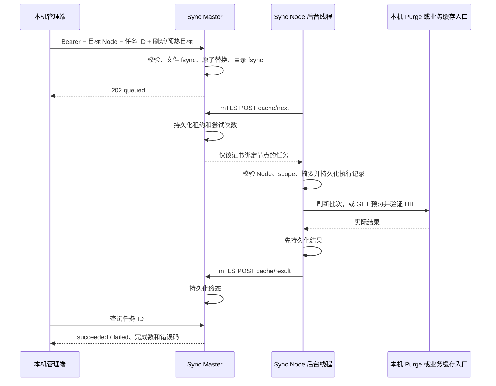

# Sync 缓存刷新与预热任务

native-sync 0.2.0 增加独立的缓存任务通道：本机管理员向 Master 投递任务，Master 持久化后返回任务 ID；Node 用登记的 mTLS 身份拉取自己的任务，在后台执行并持久保存结果，再回报 Master。此通道不传输缓存文件，也不承担配置/证书快照同步。



## 两类任务的语义

`refresh` 调用 Node 本机 Purge 的 Unix Socket，提交完成才回报成功。支持 `exact`、`prefix`、`wildcard`、`regex`、`suffix`、`directory`、`site`/`scope`、`node`/`all`。它使旧版本缓存失效，随后访问重新回源；不会主动下载新内容，也不承诺立即删除磁盘文件。精确目标必须与部署中 `scdn_purge_key` 的完整第二参数一致；模式目标按 Purge 的资源匹配合同填写，见 [Purge 手册](../native-purge/README.zh-CN.md)。

`preheat` 只支持 `exact`，正文每行是一个以 `/` 开始的 URI，可带查询串；不接受任意绝对 URL、协议相对 URL、片段或控制字符。Node 只能访问配置的缓存 scope 对应站点，并强制连接该站点端口的 `127.0.0.1`；HTTP Host、HTTPS SNI、证书主机名验证仍使用配置中的站点名。不会解析请求正文中的主机地址，也不使用系统 HTTP 代理或跟随重定向。

预热发送普通、无业务凭据的 GET。每个 URI 至多两次 GET：首次填充后验证缓存 HIT，已经 HIT 时只需一次。站点需返回 `X-Cache` 或 `X-Cache-Status`，值为原生 `$upstream_cache_status`；只有 HTTP 200 且实际 HIT 才计为完成。私有响应、BYPASS、源站错误、TLS 验证失败和重定向都不会伪报预热成功。该模式只预热无凭据的默认表示，不遍历 Cookie、认证、Accept-Language、压缩等缓存变体。

刷新后立即预热时，先等待刷新任务 `succeeded`，再提交预热任务。队列不提供任务依赖和严格顺序保证；不能同时投递后假定预热一定发生在刷新之后。批量任务可返回部分完成和 failed，不把失败项计为已完成。涉及路由版本的 key，应先确认目标 Node 已使用预期版本。

## 配置

以下为 `http` 中的启动指令。实际凭据、域名和状态目录由部署提供，不提交 Git。完整可组合模板见 [Master 缓存任务片段](../native-sync/examples/cache-master.conf) 与 [Node 缓存任务片段](../native-sync/examples/cache-node.conf)。

| 指令 | 角色 | 说明 |
| --- | --- | --- |
| `scdn_sync_cache_tasks /absolute/private/directory;` | 两者 | 启用任务；目录预先创建，0700，归实际 Worker 账户所有，不接受叶路径 symlink |
| `scdn_sync_cache_master https://sync.example.com:8443;` | Node | Master HTTPS 根 URL；不允许 userinfo、查询串或业务路径 |
| `scdn_sync_cache_mtls ca-file client-cert client-key;` | Node | 三个绝对路径；CA/主机名校验始终开启，客户端证书必须匹配 Master 登记 |
| `scdn_sync_cache_purge socket token-file /purge;` | Node | 本机 Purge Socket、独立私有 token 文件和 API 路径 |
| `scdn_sync_cache_site scope http-or-https-base-url;` | Node | scope 白名单及本机业务入口；最多 256 个且不能重复 |
| `scdn_sync_cache_local_ca ca-file;` | Node | 可选，本机 HTTPS 预热的信任链；默认系统 CA |
| `scdn_sync_cache_poll 1s;` | Node | 完成上一轮后再等此间隔；100ms～60s，默认 1s |
| `scdn_sync_cache_allow_all off;` | 两者 | 默认关闭整机任务；Master、Node、Purge 三处均需显式允许才会成功 |

在 Nginx main 上下文配置 `thread_pool scdn_sync_tasks threads=1 max_queue=16;`；Node 所用 Purge 还需自己的线程池。库依赖为 libcurl 7.85 或更新版本以及 HTTP SSL、线程池支持，见 [安装手册](INSTALL.zh-CN.md)。模块仍可在不启用任务的情况下单独运行角色查询。

`scdn_sync_cache_site` 的 scope 是缓存命名空间，与 `scdn_sync_scope` 的节点分组不同。任务同时携带并校验这两层范围。整机清理没有单个缓存 scope，受上述三处开关限制。预热入口需监听 IPv4 loopback 可达端口，并与真实流量使用相同的 Host、scheme、URI、路由及缓存 key；只在外部 VIP 监听的站点需显式补齐本机入口。

Sync 控制 token、Purge 控制 token、Node mTLS 私钥分别管理。token 文件沿用 43～128 个 base64url 字符及私有普通文件检查。任务目录和父目录不得由其他租户写入；任务正文含 URL/缓存键，属于私有运行数据。关闭控制接口访问日志。身份、URL、线程池和白名单的修改属于 Nginx 启动配置，需正常 reload；投递和执行任务不重建 Worker。

## 本机管理 API

都通过现有 `scdn_sync_api control` 暴露，同时要求真实 Unix/loopback 连接和 Bearer。拒绝查询串、编码路径、重复必需头、chunked body 和超限正文。

| 方法与路径 | 作用 |
| --- | --- |
| `POST /__scdn_sync/v1/cache/tasks` | 仅 Master 创建任务，成功持久化返回 202；相同 Node/ID 和相同内容重试返回 200 |
| `GET/HEAD /__scdn_sync/v1/cache/tasks` | 用 `X-Node-ID`、`X-Task-ID` 查询；Node 只能查自己的本地收据 |
| `DELETE /__scdn_sync/v1/cache/tasks` | 仅 Master 删除终态任务，释放容量；不能删除 queued/running |

创建请求头为 `Content-Type: text/plain`、`X-Node-ID`、`X-Task-ID`、`X-Task-Type: refresh|preheat`、`X-Purge-Mode` 和 `X-Purge-Scope`。整机模式省略 scope 并使用空正文；site/scope 模式使用空正文，其余模式每行一个目标，末尾 LF 可省略。正文至多 64KiB、256 行，每行至多 4096 字节。配置 `client_body_buffer_size 128k`，避免正文落临时文件；落盘的 body 会拒绝。任务 ID 使用与实例 ID 相同的 96 字节 ASCII 规则，应采用全新、不重复的 UUID 或业务唯一 ID。

凭据保存在 0600 curl 配置文件后，可执行：

```sh
curl --config /etc/scdn-sync-native/master/control.curl.conf \
  --unix-socket /run/scdn-sync-native-master/control.sock \
  -H 'Content-Type: text/plain' -H 'X-Node-ID: node-a' \
  -H 'X-Task-ID: refresh-demo-001' -H 'X-Task-Type: refresh' \
  -H 'X-Purge-Mode: exact' -H 'X-Purge-Scope: http|www.example.com' \
  --data-binary @/private/cache-keys.txt \
  http://localhost/__scdn_sync/v1/cache/tasks

curl --config /etc/scdn-sync-native/master/control.curl.conf \
  --unix-socket /run/scdn-sync-native-master/control.sock \
  -H 'X-Node-ID: node-a' -H 'X-Task-ID: refresh-demo-001' \
  http://localhost/__scdn_sync/v1/cache/tasks
```

预热相应设置 `X-Task-Type: preheat`、`X-Purge-Mode: exact` 并提交 URI 文件。相同任务 ID 改内容返回 409，不会覆盖已提交任务。任务 ID 在删除后也不应复用，因为 Node 可能保留该 ID 的去重收据。

状态只返回任务 ID、Node ID、type、mode、state、attempt、completed、受控 error 和 `physical_deleted:false`，不返回正文、token 或证书。`succeeded` 表示该任务实际执行成功，不能解释为站点配置已经同步或所有业务健康。

## mTLS 交换 API

`POST /_scdn_sync/v1/cache/next` 用空正文领取任务，204 表示暂时没有可领取任务；200 的正文为目标列表，响应头包含 `X-Task-ID/Type/Digest/Lease`、`X-Node-ID/Scope` 和 `X-Purge-Mode/Scope`。租约在返回前持久化。请求中的自报 Node ID 无法改变证书绑定。

`POST /_scdn_sync/v1/cache/result` 使用空正文，以及 `X-Task-ID`、`X-Task-Lease`、`X-Task-State: succeeded|failed`、`X-Task-Completed`；失败带受控的 `X-Task-Error`。结果必须匹配领取时的尝试次数和证书绑定的节点 scope；旧租约或不同终态结果返回 409。Node 自己通过原生后台线程完成这些调用，无需 Lua、Python Agent 或外部定时器。

## 持久化、并发和失败边界

每个 Node 队列最多保留 128 个任务，包含终态；满时返回 507，管理员查询并删除已完成任务后再投递。队列按节点独立加锁，单个队列文件损坏或节点离线不堵住其他节点。节点登记 scope 变化后，旧 scope 的待执行任务会失败为 `node_scope_changed`，不会跨范围执行。队列不保证 FIFO。终态文件单独标记，空闲轮询只枚举目录并检查未完成任务，不反复读取已完成任务正文。Node 只由第一个 Worker 的一个后台任务执行器运行，同一目录的执行锁防止 reload/恢复期间重复执行器并行。

任务租约 120 秒，至多领取三次；到期且尝试耗尽后标为 `failed/lease_expired`，不会无限执行。预热每个 HTTP 请求超时不超过 5 秒，整任务预算 45 秒；每个响应体最多读取 64MiB 并丢弃，不在内存缓存大响应。刷新本机调用超时 10 秒。默认轮询会产生空闲控制流量，**此通道没有宣称零轮询开销或进行生产规模性能验收**。

文件使用私有普通文件、叶路径 nofollow、校验摘要和有版本的文本记录，写临时文件、fsync、rename、目录 fsync 后才承认持久化。重启会保留 Master 队列和 Node 收据。Node 先保存执行结果再回报；ACK 丢失后租约重发会重报已有结果，不再次执行已记录的效果。Node 保留至多 128 个收据，只淘汰已被 Master 确认的终态记录。

语义为**至少一次执行**：效果发生后、Node 结果成功持久化之前发生崩溃，仍可能重做刷新或预热；不能承诺跨 Purge journal 和 Sync 收据的原子 exactly-once。存储错误不回报成功；Master 可能已经提交但响应丢失，管理端应以同一 Node/ID/内容幂等重试。磁盘损坏返回 503，保留材料检查或从验证过的备份恢复，不能把删队列当作自动修复。租约使用墙上时钟，时钟跳变可能提前或推迟重试，应保持主机时间同步。

## 当前边界

缓存任务的 mTLS、Node/scope 校验、摘要、持久队列和幂等结果属于这条任务协议。配置/证书快照的 JWE/JWS、HTTP 签名/nonce、stage/commit/rollback、完整发布历史和业务探测仍未原生化，原有能力位保持 false。缓存任务不把旧 Lua 配置同步迁移完成。验收入口为 `python native-sync/tests/cache_tasks.py --prefix /isolated/runtime`，静态构建加 `--static`。
