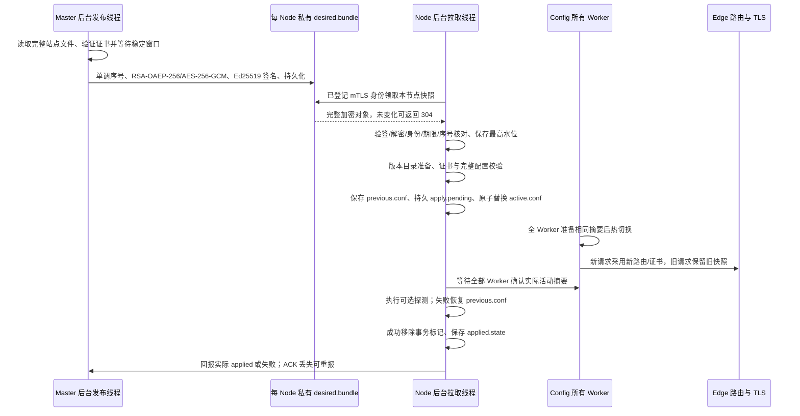

# 原生站点配置与证书发布

Sync 0.3.0 提供 Master 自动发布、按节点加密、Node 拉取校验、版本目录、Config/Edge 热应用、配置探测、回退和结果重报。它与已有缓存刷新/预热任务独立启用。本协议名称为 `scdn.sync.native.v2`，配置对象格式为 `native.snapshot.v2`；它使用固定二进制封装，不是旧 Lua 的 JWE/JWS 接口，不能把旧 Lua endpoints 直接接到新协议。

## 发布和应用路径



传输对象包含完整站点列表、Host/别名、enabled、upstream、root 引用、前缀路由、cache/tier、origin_host、缓存请求/响应头设置，以及启用站点的证书链和私钥。删除/停用依据完整集合生效；不上传静态内容文件、任意 Nginx 指令、WAF/限速实现或缓存文件。静态 root 引用的内容必须由部署在各节点预先准备，Node 会校验本机路径可用。

## 启动配置

Master 在 `http` 中配置角色、私有本机 token 和 mTLS exchange，另加：

```nginx
scdn_sync_config_state /var/lib/scdn-sync-native/master/config;
scdn_sync_config_source edge /etc/scdn-sync-native/source/sites.conf;
scdn_sync_config_signing_key /etc/scdn-sync-native/master/signing.key;
scdn_sync_config_peer_key node-a /etc/scdn-sync-native/master/node-a-encryption.pub;
scdn_sync_config_peer_key node-b /etc/scdn-sync-native/master/node-b-encryption.pub;
scdn_sync_config_allow_empty off;
```

每个 `scdn_sync_peer` 必须有相同 Node ID 的 RSA 公钥及其登记 scope 对应的 source。不同 scope 使用独立的完整站点文件；同 scope 的节点获得相同逻辑配置，但密文和 Node 绑定不同。最多 256 个 source、1024 个登记节点。Master 轮流扫描 source，轮询间隔为完成本轮后 1 秒，内容和证书摘要稳定至少 2 秒才发布；实际延迟随 source/节点数量、加密和 I/O 增长，不能当作固定 2 秒 SLA。

Node 使用相应身份和本机 token，另加：

```nginx
scdn_sync_config_state /var/lib/scdn-sync-native/node/config;
scdn_sync_config_master https://sync.example.com:8443;
scdn_sync_config_mtls /etc/scdn-sync-native/node/pki/master-ca.crt
    /etc/scdn-sync-native/node/pki/node.crt /etc/scdn-sync-native/node/pki/node.key;
scdn_sync_config_trust_key /etc/scdn-sync-native/node/trust/master-signing.pub;
scdn_sync_config_decryption_key /etc/scdn-sync-native/node/decryption.key;
scdn_sync_config_status_socket /run/scdn-sync-native-node/control.sock;
scdn_sync_config_allow_empty off;

scdn_config_managed /var/lib/scdn-sync-native/node/config;
scdn_config_zone configurations 128k;
scdn_config_interval 250ms;
scdn_config_settle 500ms;
# Optional real business probes; configure paths/statuses appropriate to updates.
# scdn_sync_config_probe https://www.example.com/health 200;
```

Node 状态 Socket 的 server 同时提供 `location = /status { scdn_config_status; }` 和已有 Sync control。Config 状态附带受管目录摘要，Sync 核对与自身 state 目录一致；配置普通 `scdn_config_watch` 或指错目录不会被当作已接入事务。`scdn_config_managed` 和 `scdn_config_watch` 互斥。

main 上下文需定义 `thread_pool scdn_sync_distribution threads=2 max_queue=16;`、`thread_pool scdn_sync_publisher threads=1 max_queue=2;`，Node 另需 `scdn_config_reader`。一个实例的第一个 Worker 调度后台发布/拉取；磁盘和网络在这些后台线程执行，业务 Worker 只处理就绪回调和短共享锁。

完整片段见 [Master](../native-sync/examples/distribution-master.conf) 和 [Node](../native-sync/examples/distribution-node.conf)。目录预先创建为实际 Worker 所有的 0700，Node 首次启动前提供一份验证过的 `active.conf` 作为 bootstrap；已有站点可用上一有效配置，空启动应显式启用 Config/Sync 的空集合选项。不能把任意现有服务目录直接作为新 state 目录接管。

Master 签名使用 Ed25519 私钥，Node 配置对应固定信任公钥；每个 Node 使用独立 RSA 2048～8192 位解密密钥，Master 仅持有相应公钥。私钥必须是权限受限普通文件，读取拒绝路径 symlink。示例只列路径，真实私钥、证书、源站及站点文件不提交仓库。mTLS 身份、对象加密密钥和本机 Bearer token 分开管理；密钥轮换需同步信任配置和登记，不自动信任载荷提供的公钥。

## 数据和一致性边界

配置源码最多 4MiB、单链最多 256KiB、私钥最多 64KiB、整个明文快照最多 16MiB。原生 Config 的字段/Host/证书匹配规则同样应用于 Master 和 Node，Sync 复用同一解析器；未知字段、半写、重复 Host、证书/私钥不匹配或源文件不可读不会发布新 desired。

对象采用 AES-256-GCM，随机 256 位内容密钥由对应 Node 的 RSA-OAEP-SHA256 加密；Node ID、scope、序号、签发/到期和明文摘要绑定到封装。外层 Ed25519 验证通过后才解密，不由未受信字段选择算法。对象有效期 24 小时，Master 在剩余不足 1 小时时按新序号续发；保持 Node 应用的已有配置不因 Master 离线或对象到期自动删除。

Node 持久保存最高已验证序号和摘要，拒绝旧序号以及相同序号不同内容。回退到旧业务内容由 Master 发布**新的序号**，不能把旧 desired 文件当作回退。`If-None-Match` 仅节省相同已应用对象的下载；本机最高水位仍核对，不绕过反回滚。协议依靠真实 mTLS 和序号/摘要约束报告，未声称兼容旧 Lua 的 HTTP 请求签名/nonce 合同。

每次完整对象落入 `releases/r<sequence>/`。Node 将证书路径改为本机版本目录，再重新验证配置。`previous.conf`、其校验摘要和 `apply.pending` 在改 active.conf 前持久化。Config 启动遇到未完成标记时先校验并恢复 previous.conf；错误 marker/backup 会拒绝启动，不能静默使用半完成候选。在线 `nginx -t` 或 reload 与正在应用的事务发生锁冲突时会拒绝恢复操作，待事务结束重试。

Config 已有的全 Worker 准备屏障负责热切换。Node 另等待全部 Worker 的实际活动摘要与预期一致，等待预算约 15 秒加最后一次本机请求的超时。可选探测失败时恢复上一有效文件并等待回退；回退无法确认时保留 marker 并报告 `recovery_required/rollback_pending`。因校验、Worker 应用超时或探测而拒绝的版本保存失败收据，不每秒反复切换同一候选；需要修正源文件并发布新序号。

可选 `scdn_sync_config_probe URL STATUS` 最多 32 个，只支持 HTTP/HTTPS，禁止 URL 凭据和重定向，HTTPS 验证 CA/主机名。它校验管理员指定路径及状态，不证明全部业务健康；配置停用/删除也要考虑探测路径的预期。未配置探测时 business_health 为 unknown。缓存任务不代替配置应用结果。

成功后持久 applied.state，再回报 Master。报告 ACK 丢失会从本机收据重报，不重做配置切换。正常更新后 GC 只清理不被 active.conf/previous.conf 引用的已识别版本文件，每轮有界；当前和回退版本保留。异常临时文件和未知目录由运维检查处理，不递归删除未知内容。磁盘满、日志/状态写入失败不回报假成功。任意旧备份恢复都须包含一致的源配置、证书版本、最高水位及状态，不能单独回滚最高序号文件。

## API 与观察

| 入口 | 方法 | 语义 |
| --- | --- | --- |
| `/__scdn_sync/v1/status` 或 `/__scdn_sync/v1/config/status` | 本机 GET/HEAD + Bearer | 启用发布后返回实际发布/应用状态、序号、应用摘要及受控错误 |
| 同上，带 `X-Node-ID` | Master 本机 GET/HEAD | 读取指定登记 Node 的发布/报告状态 |
| `/_scdn_sync/v1/config/desired` | 已登记 mTLS GET/HEAD | 只返回证书身份绑定 Node 的加密对象；未发布为 204，相同已应用为 304 |
| `/_scdn_sync/v1/config/result` | 已登记 mTLS POST，无正文 | 报告当前发布序号/摘要和实际应用结果；旧版本或错误摘要返回 409 |

控制层继续拒绝查询串、编码路径和非法请求正文。结果字段使用 `X-Config-Sequence`、`X-Config-Digest`、`X-Config-State`、`X-Config-Error`、`X-Config-Applied`，不使用产品前缀。未启用 config_state 的角色接口保留 not_started/空 applied；启用后按实际状态展示，不能继续硬编码未开始。

状态文件和 API 返回 `published`、`applying`、`applied`、`source_rejected`、`failed` 或 `recovery_required`。published 只代表 Master 的密文已持久；Node applied 要经过本机配置和 Worker 确认。角色本身正常、缓存任务成功或单个 HTTP 200 均不足以证明配置应用完成。

## 迁移和验证

先让原 Lua 同步继续作为现有部署的唯一写者，在独立目录/端口验证原生 v2。确认 Node 收到正确站点、删除/停用、TLS、在途连接和回退后，再交接配置写入权并停止旧 publisher/Node apply。不要让两者写同一个 active.conf。此仓库变更不自动修改生产服务、证书或进程。

`python native-sync/tests/distribution.py --prefix /isolated/runtime` 用一个真实 Master、两个真实 Node、每实例两个 Worker 验证发布、密文隔离、路由/证书热变更、异常源、篡改/重放、探测回退、ACK 恢复、Master 离线和启动回退；静态构建增加 `--static`。容量、跨地域网络、完整磁盘/掉电矩阵和自动密钥轮换需在部署环境另验收。
