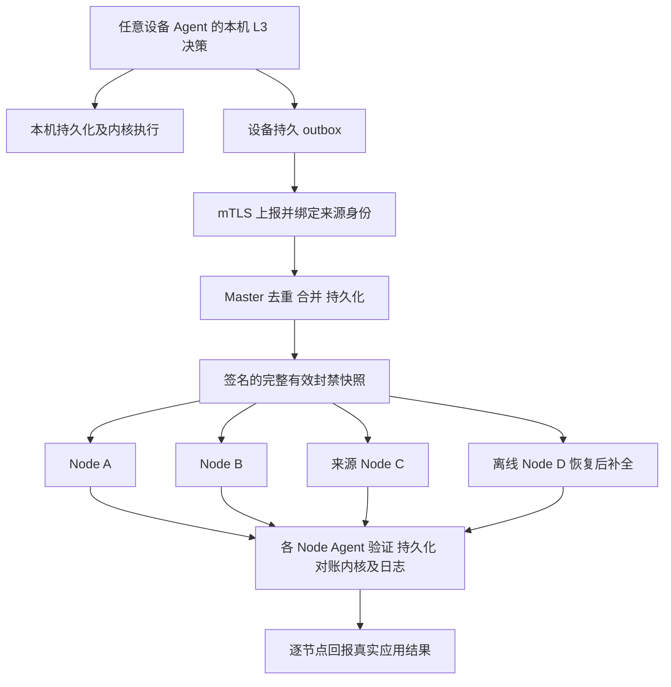

> 历史设计记录：Ban 0.1.0 已实现原生模块、Agent、XDP/TCX 和全节点同步。实际 JSON、SQLite WAL、运行 ABI、容量和当前验收以 [运行手册](../RUNTIME.zh-CN.md) 为准；下文保留设计阶段合同与未来扩展用例。

# 全节点 IP 封禁同步合同 v2

日期：2026-11-15。状态：Ban 设计合同；尚无 Ban Agent、内核执行器或本页交换 API 的运行实现。现有原生 Sync 的缓存任务通道不能当作封禁同步已经实现。

## 1. 所有设备产生、所有节点接收

任意已登记设备的 Agent 接受 CC/L3 升级或受权人工 L3 封禁后，先执行本机的持久化/内核确认流程，同时写入自己的持久 outbox。包括 Master 所在设备；不能只收集某个中心设备产生的封禁。Master 依据 mTLS 登记把传输身份绑定到设备 UUID，汇总成集群权威有效 L3 集合。所有登记 Node 都接收相同完整集合，包括来源设备及临时离线设备。

本合同的全节点集合为同一受信集群中的全部设备；不按 Sync 的站点 scope、地域或缓存队列目标裁剪。外部防火墙/交换机只有登记适配器、可信身份和可恢复事件源后才算接入；不能从客户端请求头、任意文件或未知内核程序猜测封禁来源。

WAF 仍先产生站点 L7，频繁时升级为 L3。L7 本身不提升为所有节点的 L3；本次强制全节点同步对象是所有来源的有效 L3 封禁。已有 L7 的站点键和升级证据规则保留。动态封禁记录与站点配置、缓存任务、缓存文件分开存储。

## 2. 全量的含义

每次有效集合变化，Master 生成递增 revision 的**完整快照**，包含全部当前有效 L3 IP 和各自的全局 ban_id、绝对到期、原因、策略代际与来源摘要。每个目标节点下载完整对象并完整校验，不能只给其他节点发送新增 IP 后把它称为全量同步。历史已过期/已解除 IP 留在两类日志及权威审计中，不继续作为有效内核封禁下发；全量指当前完整有效集合。

初次加入、重连、丢失本机状态、应用摘要不一致和恢复检查点，都从最新完整快照恢复。空集合也是有效且需签名的完整快照；超时、404、缺页、验签失败和读文件失败不能被解释成空集合。相同 revision/摘要已经完整应用时允许 304 或只传元数据；集合发生变化时仍传整个新对象。连续变更可在有界合并窗口内合并为最新完整集合，不能不断延期发布。

快照按 cluster_id、authority_epoch、revision、对象 SHA-256 绑定。authority_epoch 变更须显式授权恢复/切主，不能把未知新 epoch 自动当作可信。相同 revision 内容冲突拒绝；同 epoch 的旧 revision 不覆盖新状态。快照分块时，分块序号/数量/大小和总摘要都必须匹配，完整对象验证前不动活动内核表。记录数乘固定记录长度必须恰好等于正文长度，检查整数溢出、保留位、规范化地址、排序和重复 IP；不能接受重复键后按最后一条覆盖。签名密钥由本机信任配置固定，不能接受载荷自带的临时公钥或算法降级。

## 3. 固定期限及同 IP 多来源

来源 proposal 保留不可变 event_id、来源设备、持久 producer_seq、原始决策 UTC、原始 expires_utc、TTL、策略代际和已执行层。普通命中、转发、重试和全量重放都不是新决策，不能改变 expires_utc。

Master 为同一 IP 的有效封禁轮次分配全局 ban_id。轮次未到期时其他设备报告同 IP，只合并来源证据，不把固定到期往后推；仍有效且更早的原始期限可以收紧当前期限。过期 proposal 只进入历史/回执，不启动新的轮次。上一轮到期后的新可信原始决策才可以创建新轮次。策略更新不延长已有轮次。来源相同 event_id 改内容返回冲突；已收取序号和撤销墓碑必须持久化，不能靠短期内存去重保证不复活。

跨机不传 BOOTTIME。快照使用可信 UTC 的绝对到期；接收节点校验时钟误差预算，以 `max(0, expires_utc - local_utc - uncertainty)` 换算本 boot 的剩余期限。同一 boot 重放时取已有截止和换算结果中的更早者，不因时钟回退延长。可信时间未就绪时拒绝确认新远程封禁已应用，保留已有本机 BOOTTIME 到期行为并上报 CLOCK_UNCERTAIN。

## 4. 本机合并与防循环

Agent 的期望执行状态是 `有效全局快照 ∪ 尚未被 Master 接纳的本机有效 L3 意图`。快照缺少某个 IP 不能删除尚未上报成功的本机封禁。Master 回执把本机 proposal 绑定到全局 ban_id/期限后，再按权威记录收敛。

每条记录明确 origin=local_decision 或 origin=cluster_snapshot。接收远程快照、内核 DROP 计数、兜底拒绝和副本重放不产生新的源事件，不重新进入 CC/WAF 证据窗口，也不再次上报成自己的决策。源设备必须正常接收并 ACK 权威快照，不能以“我已有这个 IP”跳过全表校验。

全量应用先验证并预留容量，持久 PREPARE，再添加/更新新有效记录，最后按 ban_id 和代际核对删除已被权威撤销的旧副本。不能先清空 Hash Map 再填充。当前 Map ABI 没有整表原子切换保证，因此应用期间状态为 APPLYING；只有全部目标项、删除、共享视图和两类日志均对账后才回报 APPLIED。Map 满或一项失败时保留原有效保护并返回 PARTIAL/APPLY_FAILED，不报整表成功。GC 不删除后来产生的 ban_id。

全局人工解封作用于明确 ban_id 和 revision，产生持久墓碑/事件时间水位并进入下一完整快照。普通来源设备不能撤销其他设备或整个集群的封禁；撤销其本机待上报意图也要保留不可重放回执。迟到旧事件和迟到旧快照不能重新封禁。新的真实攻击在管理解封后可否再封，由显式临时豁免决定，不能把解封伪装成永久白名单。

集群豁免策略由同一权威版本控制：Master 不把命中全局豁免的 IP 发布为有效封禁，节点核对相同策略版本。节点私自增加本机豁免而跳过全局项时必须上报 NOT_APPLIED/策略不一致，不能声称全部生效；运维紧急豁免需成为可审计的集群策略变更。全量 IP 集合一致不改变各节点已配置的 Web/LB 入口保护边界。

## 5. 传输与权责

以下是待实现的独立 Ban 交换命名空间，现有模块不会返回成功：

| 操作 | 权限及持久边界 |
| --- | --- |
| `POST /_scdn_sync/v1/ban/proposals` | 设备 mTLS，只能上传本身份的原始决策/撤销本机待提交意图；Master 持久化后返回回执 |
| `GET /_scdn_sync/v1/ban/snapshot` | 所有登记 Node；返回最新完整快照/签名对象元数据，绑定集群身份 |
| `POST /_scdn_sync/v1/ban/results` | Node 回报 downloaded/validated/durable/applied、实际内核结果及摘要；不能代报其他节点 |
| 本机受权全局解除/查询 | Unix/loopback + 独立管理凭据；生成权威撤销记录，不接受公网请求头授权 |

每个来源使用独立持久 outbox，批次和正文有界。单个来源非法事件、慢节点或永久错误不堵住其他来源/节点。Master 采用单权威写者和持久 authority_epoch/revision；没有经过 fencing 的双 Master 不允许同时发布。来源事件经受信 IPC 接入本机 Agent，Nginx Worker 不直接做跨机请求或写远程队列。

传输使用 mTLS，并对不可变完整对象签名/校验摘要。按安全策略加密保存包含真实 IP/站点的发布对象；不进入公开仓库或普通访问日志。不把缓存任务 120 秒/三次领取的通用任务模型套给封禁：节点离线不能造成集群有效封禁投递被丢弃，恢复时必须重新对账最新全量。

## 6. 全节点完成与离线恢复

Master 为每个 membership revision 固定当时的全部目标节点。只有这些节点都回报同一目标 revision/摘要的真实内核与日志结果，才表示该版本 ALL_APPLIED；有离线节点时状态为 PARTIAL，必须列出待同步数量和受限身份。下载成功或 API 200 都不等于内核已丢包。集合继续变化后，展示最新目标版本与每节点实际版本/滞后，而不是用旧版全员 ACK 冒充当前完成。

新节点完成最新全量核验、内核加载和 ACK 前处于 SYNC_PENDING，业务接入遵守明确的准入策略。已经服务的节点断网时继续执行已有本机/集群封禁至各自原期限，同时保留新本机决策的 outbox；Master 恢复后先幂等接收这些原始决策，再让各节点收敛最新全量。断网不能保证未知 IP 同时在隔离节点生效，应如实呈现滞后，不虚报即时一致。

## 7. 有界实现和日志

配置见 [策略 Schema](policy.schema.json) 的 cluster 对象。默认合并窗口 100ms、重连后检查最新全量、一次一个对象；合并窗口必须有最大等待，下载/验签/应用各有独立预算。Master 每 revision 只生成一次不可变、可压缩对象，所有 Node 复用该对象；不能每个拉取都扫描并重新序列化全 IP 表。全量传输成本随有效表大小与节点数增长，需要测量带宽/CPU，不能承诺与增量相同开销。

容量满、快照超过配置上限、磁盘失败、缺少 key/证书、Map/日志失败均显式报错，不截断成“不完整全量”。过期/已撤销记录的 GC 需有已持久的来源序号水位与权威检查点，旧备份恢复不得降低反重放水位；长离线设备恢复时先取得权威 fence，不能重放已被回收语义的旧 proposal。

两类指定日志都保留事件来源设备、全局 ban_id、原始 event_id、authority_epoch/revision、固定期限和 local/cluster 执行原因。Master 记录接收/合并/发布/逐节点结果；各 Node 记录收到/验证/内核应用/到期/解除。重复快照不重复制造 ban-created 日志，重试和应用失败有自己的事件。日志文件不作为传输队列或权威数据库。

验收见 [集群用例](ACCEPTANCE.zh-CN.md)。该合同取代 v1 中“动态封禁不默认跨节点同步”的约定；现有本机固定期限、单写者、Web/LB 入口和审计要求继续适用。
