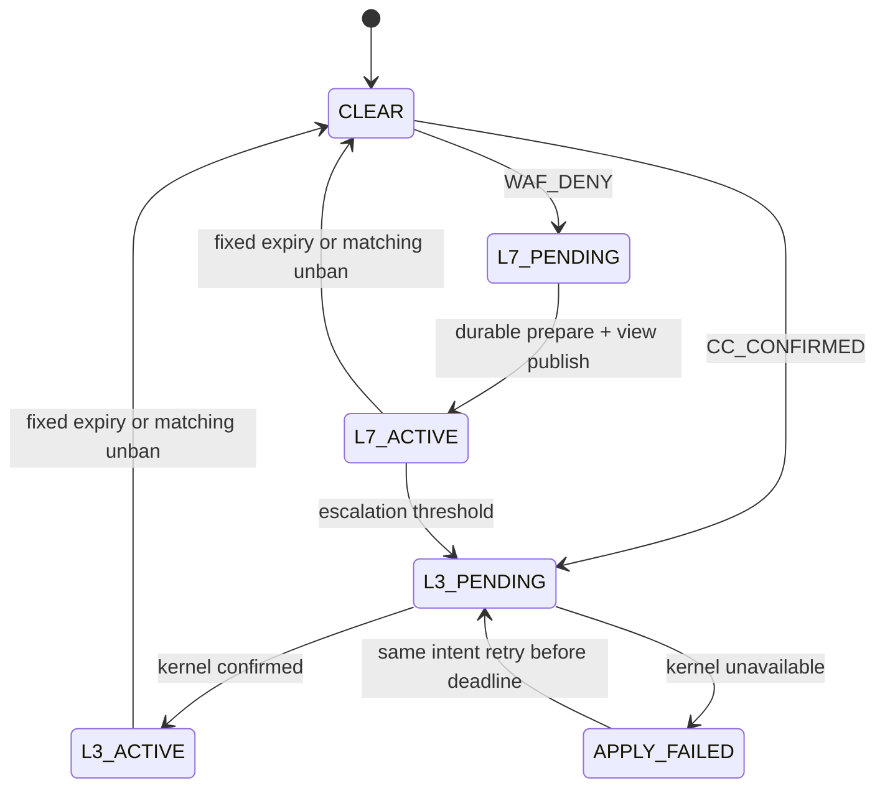

# IP 封禁与 eBPF 联动详细设计 v2

日期：2026-11-15。状态：设计草案。工程基线为插件仓库 `d07973a`。ABI、示例和验收项是实现输入，不表示已经提供运行能力。

## 1. 范围和决定

- 客户端直接访问节点，规范化的传输对端是 IP 封禁身份；不接纳客户端头部指定的封禁地址。
- L7 键为 `(site_id, IP)`，L3 键为源 IP，作用于配置列举的 Web/LB 业务入口。纯 TCP/UDP 负载均衡入口不执行 HTTP WAF。
- WAF 确认拦截建立 L7；可信 CC 事件直接申请 L3；窗口内的 WAF 拒绝与有效 L7 封禁命中达到阈值时升级 L3。
- 固定期限从 Agent 接受事件并作出该次决策时起算。传输、持久化和重试消耗该期限，不重置它。升级是新的 L3 决策；普通命中不续期。
- 单个节点使用一个 Agent、一个控制写者；所有 Worker 和已登记 Nginx 实例读同一共享视图。首版支持 Linux 64 位小端、零 BOOTTIME 偏移，按 Linux 6.6/6.12 LTS 验收。
- 首版为显式选择的 XDP native 或 TCX ingress，无静默兼容降级。TC egress、硬件 offload、HTTP/3 L7 适配另做能力扩展；UDP 的 L3 封禁不依赖 HTTP/3 解密。

- 所有设备产生的 L3 封禁必须全节点同步。Master 汇总成相同完整有效表，来源节点同样接收；跨机保留原始绝对到期，不能重起 TTL。细节以 [集群全量同步合同](CLUSTER-SYNC.zh-CN.md)为准。

## 2. 必须保持的约束

| 编号 | 约束 |
| --- | --- |
| I01 | 无可信安全事件不创建自动封禁；403/429 或 AI/SSE 标签本身不算攻击 |
| I02 | 只有 Agent 写正式封禁；Worker 无 BPF Map FD、加载能力及日志写入职责 |
| I03 | 每次主请求在频率窗口计一次，重传、子请求和内部跳转不重复计数 |
| I04 | 有效封禁不被 LRU 或内存压力静默淘汰 |
| I05 | 每次决策保存绝对到期，命中/重连/恢复不重新起算 TTL |
| I06 | 正式封禁执行前存在已持久 PREPARE，未确认内核更新不报告 L3 生效 |
| I07 | 管理解封和 GC 校验 ban_id，不能删除后来产生的新记录 |
| I08 | Nginx Worker 查本机只读内存，不逐请求读取策略文件、Map 或远程服务 |
| I09 | 配置版本、事件确认、实际执行层与日志持久状态分别呈现 |
| I10 | 代理请求头不替换直连传输身份；IPv4-mapped IPv6 归一成 IPv4 |
| I11 | 有效封禁视图损坏或读取不稳定不能被解释成“未封禁” |
| I12 | 原子记录不等于跨 Map、文件和进程的全局原子事务 |

## 3. 组件接口与请求顺序

`ngx_http_scdn_ban_module` 提供前置检查和事件上报；`scdn-ban-agent` 承担策略、计数、持久化与执行；BPF 只做入口匹配、地址查表、期限判断和计数。stream 适配只查节点级 L3 状态/兜底，不增加协议内容检测。

拟议 C 接口语义：

```c
/* API shape only; declarations will bind to Nginx types during implementation. */
/* precheck(request, stable_site_id) -> DECLINED / 403 / 503 */
/* report(request, WAF_DENY | CC_CONFIRMED, registered_reason_id)
 *     -> QUEUED / BACKPRESSURE / INVALID */
```

`QUEUED` 只表示本机队列接收，不表示持久或生效。判定器独立拒绝当前攻击请求，不等待 Agent 的磁盘同步。v1 不默认发布未经审计的临时 IP 封禁；正式状态由 Agent 在持久意图之后发布，生效延迟必须测量。

顺序固定的部分为：传输身份与站点解析 → Ban 前置检查 → 必要的 API 有界识别/正文准备与实际 WAF/CC 判定 → 缓存/代理/静态文件。内容 WAF 可保留其需要正文的执行阶段；本设计不承诺把现有 Lua WAF 强行提前到 API 预读之前。已封 IP 的廉价检查必须早于正文预读。Edge 在现有 `ngx_http_scdn_api_prepare` 和命名跳转之前显式调用 Ban；静态入口同样接入。独立 API dispatch 也要显式接入这一检查，不依赖 PREACCESS handler 的偶然注册顺序。

请求池保存主请求 ID、最高已报告事件等级及已计数标记，内部重定向不丢失。Lua 适配采用模块变量 setter，先提交受控 reason_id，再触发事件；变量不得从任意请求头或状态码赋值。地址由模块取得。HTTP/1.1、HTTP/2 使用实际 TCP 对端；QUIC 需要单独受信传输适配。

## 4. 状态与升级



待执行和失败是 Agent 状态，不当作内核已经生效。一次有效升级生成新的 L3 ban_id 并保留 parent_ban_id；L3 生效后先发布节点影子，再标记相关站点 L7 为 SUPERSEDED。L3 结束后不复活这些旧 L7 记录。

同一个 L7 记录再次命中只累计证据。已有 L3 的重复 CC/WAF 事件不新建期限。到期后有新的真实请求证据才可产生新 ban_id。决策时已经过期或排队耗尽期限的意图记作 EXPIRED_BEFORE_APPLY，不重新计算完整 TTL。

L3 申请失败时，WAF 升级保留原 L7 记录和原期限；CC 可以建立节点级 `L7_FALLBACK`，期限为原 CC 决策时间加固定 L7 时长。该记录明确保存 `requested_layer=3, applied_layer=7`；恢复到 L3 仍使用原决策的 L3 截止时间，不能以重试时刻续期。纯 L4 流量没有适配器时不能声称存在应用侧兜底。

自动封禁豁免不跳过当前 WAF 或业务授权。新增豁免以有审计的撤销处理已有自动封禁，之后移除豁免不复活旧 ban_id。管理员硬拒绝不作为本组件的自动封禁记录混合管理。

## 5. 精确窗口与事件去重

计数权威位于 Agent，统一所有已登记 Worker/实例。以 `CLOCK_BOOTTIME` 事件时间评价 `(now-window, now]`，保存每 IP 最新 N 个已接受请求的时间戳，N 是阈值；允许不同 Worker 的事件乱序，按时间插入并剔除窗口外数据。N 个窗口内的有效时间戳足以作出升级，不必永久保存全部命中。

- 唯一请求键为 `(instance_id, request_id)`；单请求多个 WAF 规则只计一次。
- 同请求后到的更强 CC 信号可以升级动作，但频率仍只计一次。
- WAF_DENY 必须来自已登记可自动封禁规则；CC_CONFIRMED 也必须来自独立登记的确认规则，普通 rate 拒绝不隐式升级。
- L7_HIT 仅来自 WAF 建立的站点 L7_ACTIVE，必须携带当前有效的 observed_ban_id，且匹配站点、IP、原请求时间；L7_FALLBACK、L3 影子或读取错误产生的拒绝不进入升级窗口，旧 ban_id 在解封/升级后不能作为新证据重放。
- L7_HIT 表示明确选择的“封禁期间继续访问”升级信号，不伪造新的 WAF 内容命中；不把输出的 403/429 状态反馈成输入事件。
- 拒绝跨 boot、未来时间、超过 max_event_age_ms 或已失效策略版本的事件；不重写其时间后重试制造新证据。
- 请求去重与计数容量满时拒收新证据并告警，不淘汰未过期去重键后冒险重复计数。已有封禁继续执行。

策略版本切换、人工解封以及该 IP 当前处置轮次结束时重置其证据窗口，但不改变其他仍有效封禁的期限。处置轮次结束指 L3 到期，或已经没有仍有效的站点 L7；单站点到期而其他站点 L7 仍有效时继续保留窗口内已接受的历史。记录重置时间，窗口左边界取 `max(now-window, reset_time)`，迟到的重置前事件不重新计入。新的配置代际不回溯重新解释已经拒收的旧事件。

## 6. Agent 单写的只读共享视图

采用 Agent 拥有的**具名 tmpfs 共享文件**，例如 runtime_dir 下的 `view-v1`。文件大小在生命周期内固定；Agent 独占写映射，Worker 通过已认证连接接收 O_RDONLY FD，并使用 PROT_READ/MAP_SHARED 映射。运行目录和 inode 由 Agent 所有，Worker UID 与 Agent UID 不同，目录/文件不得向 Worker 授予写入权限。

这样不依赖 Nginx 匿名共享区或多 Worker 写者选举。同一 boot 下 Agent 重启可在取得单实例文件锁后重新打开**同一 inode**，与保留旧映射的 Worker 继续共享状态。普通请求不进行文件系统读取；文件位于 tmpfs，且需预分配/预触页并测量实际驻留内存。

不对运行视图使用 F_SEAL_FUTURE_WRITE：它保留旧写映射却禁止新写映射，妨碍 Agent 崩溃后的写者恢复。v1 使用 UID 隔离、只读 FD、目录权限、单写者锁和不可变尺寸约束；root 或受信 Agent 的恶意修改不在该只读隔离的防护范围内。

布局见 [scdn_ban_view.h](scdn_ban_view.h)：256 字节头、独立 L7/L3 索引、每槽两个 176 字节记录银行和 64 位提交字。一个 448 字节槽按 64 字节对齐。L7 完整键包含最多 96 字节站点名及规范化地址；节点键 scope 长度为零，不截断身份为短哈希。

读写协议：

1. Agent 编码完整记录，写入非活动 bank 的 22 个原子 64 位字。
2. Agent 原子发布递增版本与 bank 选择位；发布之后才能确认该视图记录生效。
3. Worker 读提交字、复制 bank 的原子字，再读提交字；两次相同才使用。
4. v1 先使用 seq_cst 原子访问，避免普通 memcpy 的数据竞争；64 位原子必须 lock-free。版本到上限时受控维护，不允许 ABA 回绕。
5. 最多重试 3 次；持续不稳定返回当前请求 503，不能当作未封禁，也不生成攻击事件。Agent 若停在非活动 bank 写入中，旧活动 bank 仍完整可用。

哈希使用随机种子和完整键比较，最多探测 64 个槽，负载上限 50%；不搬移仍可被读者访问的活动槽，删除为 tombstone。探测耗尽视为容量不足，不能驱逐有效封禁。表槽数取可容纳两倍 active 容量的下一二次幂；视图下限为 `256 + 448*(l7_slots+l3_slots)`。示例约 70 MiB，由所有 Worker 共享，不是每 Worker 一份。

Agent 恢复原视图时不先全表清零：先加载 WAL/检查点与 pinned Map，按 ban_id/序号原地对账，保留有效状态。视图比日志更新、身份不匹配或文件尺寸/布局损坏时进入 RECOVERY_REQUIRED，不用旧日志覆盖。更改表容量或 ABI 属于单独维护操作，v1 普通热配置拒绝隐式 resize/unlink/ftruncate；活跃读者存在时不得破坏旧 inode。

每条记录的 policy_generation 用于审计与来源追踪，不要求等于头部的最新策略代际；旧代际的有效封禁仍须执行到原期限，不能因普通热更新而隐式放行。

## 7. Unix 协议与权限

事件口和管理口分离。双方检查 SO_PEERCRED；Agent 只接受配置的 instance UUID/Worker UID，管理口按 admin_uids 授权。相同 UID 的进程属于该信任边界，应使用专用账户。网络请求不能直接提交封禁命令。

运行目录由 Agent UID 所有、event_gid 为组，模式 0750；事件 Socket 为 0660 并核对实际 Worker UID，管理 Socket 默认 0600。视图 inode 为 Agent 所有的 0600，Worker 通过 SCM_RIGHTS 得到只读能力，无需直接打开该路径；Agent 所有者可以在恢复时重新打开。日志的 0640 读组由受信部署目录/服务组配置，不自动扩大 Worker 的日志访问权限。管理 UID 白名单仍需相应的操作系统连接权限，默认 root 管理。

头与固定消息见 [scdn_ban_wire.h](scdn_ban_wire.h)。所有 `_le` 整数为小端，地址按网络字节序；不能将未对齐 socket 字节直接转换成 C 结构体。

| 消息 | body | 附带 FD |
| --- | --- | --- |
| HELLO | 64 字节，instance/boot/cycle、slot、预期 Worker 数、role | 正好两个只读 namespace FD：net 和 time |
| HELLO_ACK | 64 字节登记确认，含 durable_producer_seq | 无 |
| EVENT_ACK | 64 字节事件确认 | 无 |
| SECURITY_EVENT | 272 字节，唯一请求、事件时间、来源、地址、scope/reason、观察到的 ban_id | 无 |
| VIEW_OFFER | 64 字节，view/boot UUID、代际、文件长度、布局 | 正好一个 O_RDONLY 视图 FD |
| VIEW_ACK | 32 字节 | 无 |
| QUERY / QUERY_REPLY / UNBAN / ERROR | 有长度上限的 UTF-8 JSON，头 flags=JSON | 无 |
| PING / PONG | 空 | 无 |

每个 SOCK_SEQPACKET 帧最多 8192 字节、头固定 64 字节。拒绝 MSG_TRUNC/MSG_CTRUNC、未知版本/类型/flag、非零保留字段、非法长度和额外 FD，及时关闭拒收 FD。字符串以明确长度保存，余部全零，scope/reason 只用规定 ASCII ID，不接受控制字符。IPv4 位于地址后 4 字节，前 12 字节为零；IPv4-mapped IPv6 必须转换成 family=4。

HELLO 的两个 namespace FD 用 NS_GET_NSTYPE/fstat 核对类型和与 Agent 的身份一致；Agent 自身要求 BOOTTIME 偏移为零。无需 setns，也不按客户端提供的路径打开 namespace。跨时钟域不能直接比较 BPF 与用户态期限。

producer_id 是每 Worker 生命周期的随机 nonce，重连不变。只有 SECURITY_EVENT/UNBAN 使用从 1 开始递增的 producer_seq；HELLO、查询、心跳、视图交换等控制消息的 seq 为 0，不制造持久高水位空洞。应答关联原请求的 producer/event ID 和序号；主动视图通知使用 Agent 身份和 seq=0。

HELLO_ACK 返回最后已持久接收的 producer 序号，重连后顺序重发其后的未确认变更。seq 跳跃拒绝并要求重同步；近期重复 seq 只有 payload 摘要一致才返回重复回执，不重复执行。旧回执已回收时返回 STALE/NEED_VIEW，不假装原操作重新成功。receipt 容量至少为 Worker 队列的两倍。

通过帧校验的变更在消费序号前持久保存接收回执；无新动作的有效计数与过时拒收也保存回执。语法错误关闭连接且不消费，背压也不消费。最近窗口与去重状态包含在恢复检查点中。发送方只在 ack.wal_seq 非零、接收回执已持久时释放队列项；DURABLE_PENDING 即可转交后续责任，不能把它当成目标已执行。只有 RECEIVED 时仍保留重传。通过这种区分，Agent 崩溃不会令已确认心跳或未持久队列造成序号断裂。

QUERY 支持 status 与精确 IP 查询；分页列表的 cursor 绑定状态序号。UNBAN 必须提供 ban_id 与预期状态版本，不接受无限 TTL、任意文件路径或任意 BPF program 参数。JSON 中 64 位序号、纳秒与期限均用十进制字符串，避免 JavaScript 大整数精度损失。

## 8. 确认语义与持久事务

| 确认 | 真实含义 |
| --- | --- |
| RECEIVED | 收到并验证帧，尚未表示正式封禁 |
| DURABLE_PENDING | PREPARE 已持久，执行或日志投影尚未完成 |
| APPLIED_DURABLE | 相应执行已确认，结果 WAL 与两份日志已同步 |
| APPLY_FAILED | 未达到目标执行层，附明确错误及可能的兜底层 |
| STALE / BACKPRESSURE / NEED_VIEW | 无新的封禁成功承诺，按协议查询或重新同步 |
| NO_ACTION_DURABLE | 事件已持久接收/计数，本次没有新的封禁动作 |

ack 明确 requested_layer/applied_layer，flags 分别表示当前视图、内核和两类日志。L3 影子覆盖不完整时保留这一状态；不能把只确认内核 Map 的结果描述为所有已在途请求已经终止。纯应用状态不冒充 L3。

事务顺序为：预检与预留容量 → 记录 PREPARE 并 fdatasync → 执行 L7 视图或 L3 Map → APPLIED/APPLY_FAILED WAL 并 fdatasync → 两份 JSONL 日志同步 → APPLIED_DURABLE。多条可分组同步，flush_interval_ms 是批量等待上限，不是磁盘延迟保证。Worker 不等待这些磁盘操作。

权威二进制 WAL 位于 state_dir 下，两个指定 JSONL 是可恢复日志视图。WAL 记录头为 32 字节：magic=SBW1、version u16、kind u16、payload_bytes u32、CRC32C u32、seq u64、reserved u64；整数小端。CRC32C 覆盖置零 CRC 字段后的头和原始 UTF-8 payload，payload 上限 64 KiB；序号严格递增。CRC 检测损坏，不提供防 root 篡改证明。

只截断不完整尾记录；完整记录校验失败拒绝新变更，保留已生效内核/视图直到固定到期。检查点以临时文件、同步、rename、目录同步提交，并保存有效状态、回执高水位与派生进度；持久检查点覆盖后才可回收旧 WAL 段。拒绝恢复到比运行状态更旧的序号。

events.jsonl 记录完整意图、结果和管理动作；banned-ips.jsonl 是带源 seq 的 IP 历史台账，两者保留过期记录。第二份日志失败不能使已执行封禁在历史中消失：状态为 LOG_PENDING，恢复后按 seq 补投，不报告两份都已持久。可选 active-ips.json 为原子快照，不能用作包路径判定。

轮转采用 Agent 控制的 rename/reopen，不使用 copytruncate。日志/状态目录使用受控父目录与 NOFOLLOW/openat 约束，拒绝路径别名、同 inode 的事件/IP 文件、设备/FIFO/符号链接和错误所有者。IP 被明确保留；Cookie、鉴权值、正文、Prompt 和原攻击载荷不进入本组件日志。

## 9. BPF 执行契约

[scdn_ban_map.h](scdn_ban_map.h) 固定了 IPv4 4 字节键、IPv6 16 字节键、32 字节封禁值，以及 IPv4/IPv6 的目的地址/协议/端口服务键。有效表为普通 HASH，数据面只查读，由 Agent 单写；禁止 LRU 淘汰或包路径续期/删除。过期直接 PASS/NEXT，物理 GC 由 Agent 校验 ban_id 后执行。

Map 值中的 policy_generation 同样只作追踪，不能因为当前配置代际更高而忽略尚未到期的旧记录。

包路径依次解析可读取的 L2/L3、确认目的业务 VIP、查询豁免/封禁、检查 BOOTTIME，再按协议和端口执行。未封源的普通 miss 无需读取时钟。L3 作用于配置中的所有 Web/LB 服务，不以 TLS Host 区分站点。

已封源向业务 VIP 发送非首片或无法判定 L4 的受限扩展包，按显式策略丢弃；它会扩大该 VIP 上这类包的影响范围，不能宣称仍严格只影响某端口。无法安全取得 L3 身份的畸形帧交既有协议栈处理。正常 ARP/IPv6 必需控制流量不能被粗暴全丢；VLAN offload 与 XDP 多缓冲区另做覆盖验收。

XDP 过滤必须先于 LB 的 REDIRECT。仅在既有程序兼容时使用 libxdp dispatcher，未命中链式继续、命中 DROP 终止；TCX 未命中 NEXT。拒绝盲目替换未知程序或自动改 MTU/NIC offload。所有配置接口/VIP/端口均核对后才报告 L3_READY，报告实际 program/link/map 身份及模式。

加载/挂载由受限 loader/Agent 使用所需 CAP_BPF/CAP_NET_ADMIN，预挂载 bpffs；Worker 不获得这些能力。只操作自身拥有的 pin/link，single-owner lock 防重复写者。pin 不提供跨整机重启的持久性。

## 10. 配置与恢复

配置是独立 TOML，结构见 [Schema](policy.schema.json)和[示例](../examples/ban-policy.toml.example)。未知字段拒绝。结构通过后，还必须检查跨字段/运行环境约束：

- instance ID、规则 source/id、service name 唯一；Worker UID 非 root 且不同于 Agent UID。
- max_event_age_ms 不大于统计窗口；receipt 至少是 Worker 队列的两倍；容量/内存计算不溢出且不超过 view/Agent 预算。
- 服务至少有一个 TCP/UDP 端口，规范化后去重；CIDR 用真实地址解析器验证，不能只依赖 Schema 正则。
- event/admin socket 与两个日志路径不同，解析后的 inode 也不同；runtime_dir 在受控 tmpfs 上。
- net/time namespace 和时钟偏移符合入口模型，模式/链式挂载覆盖已经核对。

TTL、规则与阈值热更新不重建 Worker；已生效记录保留原期限。服务集合变化会改变所有有效 L3 的业务覆盖范围，须记录明确的配置差异。内存容量/视图 ABI/挂载模式改变属于维护操作，普通热更新返回 REQUIRES_MAINTENANCE，保留当前有效配置。

Agent 同 boot 重启先取得独占锁，恢复 WAL/检查点和原 tmpfs 视图，核对 pinned Maps，再接纳新决策。PREPARE 后执行结果未知时按同 ban_id/原期限对账或重放，过期不重施；不编造原执行时间。Agent 离线时旧视图和内核封禁继续按原期限工作，新的事件只有排队/失败状态，现有判定器仍拒绝当前攻击请求。

整机重启生成新视图和 Map；可信 UTC 用于计算剩余期限，再转换为新 BOOTTIME。时钟回退/未同步时进入待恢复，禁止直接复用旧 boot 的数值或重新起算整段 TTL。日志、状态恢复和回退均保留版本/身份，不用手动删 pin 绕过单实例控制。

## 11. 容量、指标与实施顺序

将有效 L7、有效 L3、证据窗口、请求去重、生产者回执、IPC/WAL 队列分别限额。计数表可丢失的纯统计与必须保留的有效状态分开。满容量只拒绝新申请并暴露降级，不清空正在生效的封禁。按 possible CPU 计算 per-CPU 统计内存；默认全局计数，不给每个 IP 建立 Prometheus 标签。

指标至少包括 active_bans、event_queue_depth、event_rejected、l3_apply_latency、apply_failed、map_capacity、view_retry_failed、log_lag、wal_io_errors、recovery_required、drop_packets 和实际 datapath 状态。日志明确观测时间与有效时间，队列丢弃不能伪报已经持久。

实施分为：P1 协议/配置/只读视图；P2 L7/WAF/CC 接入、本机日志事务和持久 outbox；P3 Master 权威合并、签名完整快照、全部节点收敛及撤销；P4 XDP/TCX、IPv4/IPv6 与服务覆盖；P5 多节点故障恢复、stream 适配和隔离网络验收；P6 真实节点观察与逐项启用。全节点 L3 同步是首个可用版本的必要验收，不推迟到本机版上线之后。用例见 [验收矩阵](ACCEPTANCE.zh-CN.md)。当前未实现以上运行组件，不能据头文件或静态校验宣称真实丢包、性能或恢复已验收。

## 12. Sync 与其他模块

当前原生 [Sync](../../native-sync/README.zh-CN.md) 已有身份和缓存任务通道，配置快照同步仍按 [路线图](../../docs/SYNC-ROADMAP.zh-CN.md)实施。Ban v2 必须包含 [全节点 L3 同步](CLUSTER-SYNC.zh-CN.md)：任意设备的原始决策进入 Master，所有登记节点接收完整有效集合。不同于缓存任务的一次性分发，离线节点恢复后始终要核验最新完整表。该 Ban 运行通道尚未实现，不能因 Sync 存在便宣称生效。Master 失联期间本机固定期限继续执行，新本机决策进入持久 outbox，恢复后不重新起算期限。

动态封禁不混入站点配置。全局快照与未上报成功的本机意图取有效并集，收敛后按全局 ban_id/原始期限执行；远程副本不产生新攻击证据。只有所有目标节点确认完整内核/日志对账才报告 ALL_APPLIED；下载成功或单节点成功均不足以表示全节点完成。

本组件执行本次明确的 IP 处置策略，接收现有或未来安全判定器的事件，不实现 WAF、完整 CC 检测、业务限速或 API 鉴权。与一般安全设计中的“禁止以本模块响应状态自我强化”一致：只有显式 L7_HIT 事件进入本策略窗口，不把 403/429 再包装成 WAF 命中。

参考：[Linux Hash Map](https://docs.kernel.org/bpf/map_hash.html)、[libbpf](https://docs.kernel.org/bpf/libbpf/libbpf_overview.html)、[memfd_create](https://man7.org/linux/man-pages/man2/memfd_create.2.html)、[libxdp 执行链](https://github.com/xdp-project/xdp-tools/blob/master/lib/libxdp/README.org)、[BOOTTIME helper](https://github.com/torvalds/linux/blob/v6.12/kernel/bpf/helpers.c)。
