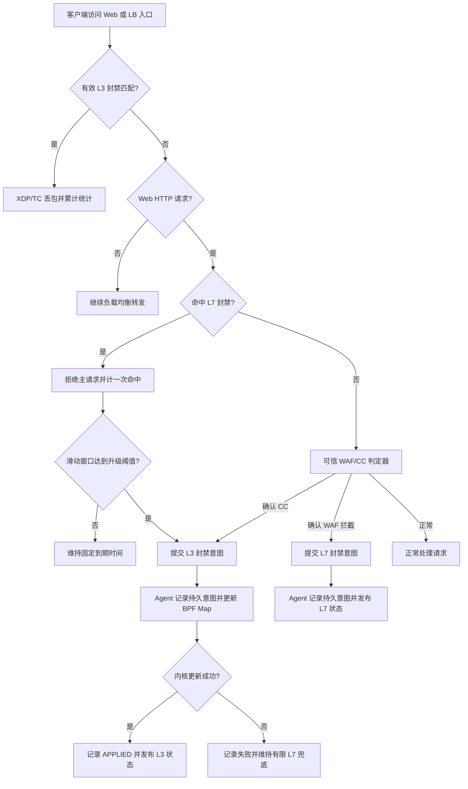

# IP 封禁与 eBPF 联动：调研结果、方案与流程

日期：2026-11-14。交付阶段：调研与设计。

已确认条件：客户端直接访问节点；L3 封禁覆盖 Web 和负载均衡业务入口；CC 确认后直接申请 L3，WAF 确认拦截后先 L7，频繁时升级 L3；封禁时长由配置固定；封禁事件与 IP 台账分别写到指定文件。

推荐方案是 **纯 C Nginx HTTP 封禁模块 + 本机 C/libbpf 守护进程 + XDP/TC eBPF 执行程序**。如果负载均衡包含 Nginx stream 的 TCP/UDP 转发，再增加薄的 stream 访问检查适配；HTTP 反向代理负载均衡直接属于 Web 入口。下述组件名、接口和配置为拟议设计。

## 1. 调研结论

1. 原生驱动模式 XDP 在分配 skb 之前处理入站包，适合已知攻击 IP 的前置丢弃。TC 在已有 skb 的路径工作，可作兼容执行点，也可以实现出站丢弃；Generic XDP 不能按原生 XDP 的开销宣传。[S1][S2]
2. XDP/TC 不在普通 HTTPS 场景下解析解密后的 HTTP、WAF 规则或站点 Host。CC/WAF 的确认来自应用侧判定器，eBPF 负责按地址、业务入口和到期时间执行。
3. 生效封禁使用有容量上限的普通 HASH Map；LRU Hash 容量满时会自动淘汰旧条目，不能用于要求完整保留的有效黑名单。LRU 可以用于允许丢失的辅助统计。[S3]
4. 到期比较放进数据面，使用 `bpf_ktime_get_boot_ns()`，用户态配对 `CLOCK_BOOTTIME`；其包含系统休眠，普通 `bpf_ktime_get_ns()` 不包含休眠。到期即停止拦截，不依赖守护进程定时删条目。[S4]
5. eBPF 丢包不会生成 Nginx 访问日志。封禁审计由控制进程记录，包统计由 Map 累计；ring buffer 空间不足会使预留失败，不能作为唯一持久审计来源。[S1][S5]
6. 客户端直连满足按真实源 IP 封禁的基本条件。封禁身份仍应来自真实传输连接，不能让任意 X-Forwarded-For 覆盖它；IPv4-mapped IPv6 需要归一化。[S6]
7. L3 不区分同一入口上的虚拟站点。某 IP 由站点 A 的 WAF 升级后，将影响本节点已配置的 Web/LB 服务；L7 则可以按站点隔离。共享公网出口的用户也共享 IP 封禁结果。

## 2. 现有代码的接入事实

已核对公开插件仓库主分支 `d07973a`，以及本工作区的 Lua 安全入口：

- 现有原生 Config/Edge/API/Purge 没有 CC/WAF 攻击确认接口。`native-api` 是业务协议识别与代理策略模块，其 AI/SSE/gRPC 等标签不应当作攻击评分。
- 新 Edge 在命名代理 location 跳转前调用 API 识别逻辑；Ban 检查必须在该分发之前执行，并覆盖静态文件入口，不能仅挂在某一个 proxy location 中。
- `lua_files/lib/waf.lua` 的 `inspect` 返回是否拦截、规则 ID 与分数；`security_guard.lua` 在其后返回 403，适合在这个确定分支上报 WAF 事件。
- `lua_files/lib/ratelimit.lua` 的 `check` 返回 `rate`，`security_guard.lua` 返回 429。这只是当前限流结果，需明确哪些规则构成“确认 CC”，再上报 CC 事件；源站普通 403/429、业务鉴权失败不自动触发 IP 封禁。
- 安全入口已考虑内部重定向的重复执行问题。新模块也必须按主请求去重，避免一次请求命中多个规则、命名 location 跳转或子请求导致重复升级。

建议提供两种受信入口：原生判定器调用 `scdn_ban_report(...)`；现有 Lua 判定器通过模块可写的 Nginx 变量 setter 发布确定的事件。后者不需要让 Ban 的 C 实现依赖 Lua；变量不得从客户端请求头直接赋值。上报的 IP 由模块从连接取得，不接受客户端指定任意 IP。

## 3. 组件与职责

| 组件 | 负责的工作 |
| --- | --- |
| `ngx_http_scdn_ban_module.so` | Web 请求入口 L7 检查、WAF/CC 事件接入、共享命中计数、固定到期、请求去重、本机异步 IPC |
| 可选 stream 适配 | Nginx stream 的 TCP/UDP 接入检查，执行 L3 状态的应用侧兜底；不称为 HTTP WAF |
| `scdn-ban-agent` | 单一控制写者、策略文件热加载、持久日志、BPF Map 更新、到期回收、重启对账、指标和管理接口 |
| XDP/TC BPF 程序 | 有界解析、白名单、业务入口匹配、封禁表查找、时间判断、丢包与轻量计数 |

Nginx Worker 不持有加载/挂载 BPF 的能力，也不在普通请求路径执行 `bpf()` 或文件同步。守护进程通过权限受控的 Unix `SOCK_SEQPACKET` 接收事件，并检查 `SO_PEERCRED`；事件发送口和人工解封管理口分开授权。

Agent 的状态通过 Nginx 内的协调连接发布到模块共享区，各 Worker 查同一份表。Nginx 自身匿名共享区不能假定可直接由独立进程 mmap；由模块协调者接收增量/快照并原子发布，使用序号拒绝旧更新。多实例时每个实例注册自己的协调连接。

## 4. 封禁规则及固定时间

| 当前状态与事件 | 处理结果 | 时间规则 |
| --- | --- | --- |
| 正常，首次确认 WAF 拦截 | 建立站点级 L7 封禁 | 首次决策时间 + `l7_seconds` |
| 正常，确认 CC | 直接申请本节点业务入口 L3 | CC 决策时间 + `l3_seconds` |
| L7 期间频繁被拒绝 | 升级为本节点业务入口 L3 | 升级决策时间 + `l3_seconds` |
| 已封禁 IP 再次命中 | 继续拒绝并累计统计 | 不自动延长当前到期时间 |
| 到期 | 自动停止相应封禁并记录结束 | 不等待磁盘删除、Map GC 或 Nginx reload |
| 人工解封 | 按 ban_id 撤销该次封禁 | 不误删后续新产生的 ban_id |

L7 默认键为 `(site_id, IP)`，L3 默认键为源 IP，作用于所有配置的 Web/LB 业务入口。升级时以 L3 取代原 L7 状态；到期后重新接受判定，不自动追加一个隐藏的 L7 封禁周期。白名单免于自动 IP 封禁，当前请求仍须经过正常 WAF/业务授权。

### “频繁”的具体定义

推荐按 IP 统计最近一个配置滑动窗口内的：**确认 WAF 拦截的主请求 + 命中已有 L7 黑名单而被拒绝的主请求**。正常成功请求、TCP 包、HTTP/2 帧、SSE 数据块均不计数。同一次主请求计一次，同一个 IPC event_id 重传不再计数。

必须计入 L7 拒绝命中：IP 进入 L7 黑名单后，后续请求会在 WAF 前返回，若只统计新 WAF 命中就可能永远无法升级。已有 L3 丢包不用于自动续期。

单 Nginx master 可在共享区按 IP 维护最多阈值数量的时间戳环，得到精确滑动窗口且内存有上限。多 master 的精确节点级聚合需要 Agent 接收有序时间戳事件；如果采用时间桶/批量统计，应明示桶宽和误差，不宣传为精确滑动窗口。

阈值与窗口是策略参数，不是根据当前未知业务流量已经确定的最优值。大量不同 IP 时，计数表、事件队列和有效封禁表分别有容量上限；有效封禁不以 LRU 静默淘汰。

## 5. 处理流程



上图表示正式状态。判定器先拒绝当前攻击请求；模块可以建立明确标记的临时保护状态，异步等待 Agent。`L3_PENDING`、`L3_ACTIVE` 与 `L7_FALLBACK` 必须区分；没有 Map 成功确认不能对外报告 L3 已生效。

事件发送为非阻塞、有限队列，按 ban_id/event_id 去重。正式生效采用 `PREPARE -> 持久化 -> 执行 -> APPLIED`，允许小批量同步摊销磁盘成本。排队时长计入这次固定期限，重试不能重新起算整个 TTL。不能同时承诺任意磁盘故障下零日志损失和新封禁零延迟生效；临时保护与正式持久确认应分别呈现。

## 6. Web 与负载均衡的覆盖边界

业务入口用 **网络命名空间、入站接口、目的业务地址、TCP/UDP 监听端口** 明确列举。例如 Web 的 TCP 80/443、UDP 443，以及实际 LB 的 TCP/UDP 端口；不把“负载均衡”解释成整机所有端口。

- HTTP/HTTPS、API、gRPC、WebSocket 使用同一 Web 入口封禁能力。L7 拒绝要在正文预读、复杂 WAF 与 API 分发前执行，降低已知封禁 IP 的处理成本。
- TCP/UDP 负载均衡由网络层按地址和业务入口拦截，不要求流量解密或经过 HTTP 模块；纯 L4 流量本身不会产生 HTTP WAF 事件。
- 如果 LB 由 IPVS/Nginx stream 等栈内路径实现，入口 XDP/TC 通常可以放在其前面，但仍要按真实接口与 NAT 位置验收。
- 如果已有 XDP 型 LB，封禁检查必须在其转发/`XDP_REDIRECT` 之前。libxdp dispatcher 可按优先级组合兼容程序；不兼容的既有程序不能强行替换。单独增加 TC ingress 不保证能看到已被 XDP 直接重定向的流量。[S7]
- 单独的入站 XDP 不保证立刻停止已经排队的出站响应。需要双向阻断时增加 TC egress，并按目的客户端 IP及反向业务元组匹配；应单独测量额外开销。已经交付的响应不能撤回，已有 TCP 连接通常表现为超时，不等于发送 RST。
- 当前 HTTP 插件构建不能作为已经支持 stream 适配的证据；若需要 stream 应用侧兜底，实施时补齐构建和 TCP/UDP 集成测试。
- UDP 443 可作为 eBPF 保护入口，但不能据此声称现有 Nginx 模块已验收 HTTP/3 的 L7 事件接入。QUIC 不能直接套用 TCP `getpeername` 取得客户端身份，需使用其受信传输上下文并独立验证。

封禁默认是当前节点已配置的 Web/LB 服务集合；不会自动传播到其他节点、外部负载均衡器或未挂载的接口。

## 7. XDP/TC 的选择与共存

| 执行位置 | 推荐用途 | 实际边界 |
| --- | --- | --- |
| XDP native/driver | 已知封禁源 IP 的高流量入口丢弃，首选 | 需要驱动支持，必须核对 MTU、多缓冲区、VLAN 和已有 XDP 程序 |
| TC/TCX ingress | 经验证覆盖相同入口后的兼容方案 | skb 已分配；与既有 XDP 直转的组合需专门验证 |
| Generic XDP | 显式选择的兼容/验证模式 | 已进入 skb 路径，不能等同于原生 XDP 性能 |
| TC/TCX egress | 可选双向封禁 | 增加出站检查；DSR 等绕过本机的返回路径需要另行处理 |
| XDP hardware offload | 后续专门适配 | NIC、驱动、Map 和 helper 能力受限，不作为首版通用保证 |

建议以 Linux 6.6/6.12 LTS、libbpf 1.4+ 做首版验收基线；需要 TCX 时注意其从 6.6 开始提供。低版本可单独评估兼容，不能仅凭“支持 eBPF”判断所有功能可用。[S2][S8]

默认不静默覆盖或卸载已有 XDP/TC 程序。程序更新校验原 program/link 身份，支持时使用原子更新；保留其他程序的优先级与链式执行语义。libxdp 中封禁过滤器先运行，未命中用可继续执行的 PASS，命中 DROP 终止链；TCX 未命中使用 NEXT 继续已有程序，避免误跳过其他安全策略。

采用 libbpf skeleton 管理对象生命周期，优先稳定 UAPI；确需 CO-RE 的部分再要求相应内核 BTF。CO-RE 不能替代驱动能力与 helper 探测。加载、挂载后需读取实际模式、program/link/map 身份，不能只凭加载命令返回成功就宣称全部接口已覆盖。[S8]

## 8. Map、时间与性能设计

建议 Map：IPv4/IPv6 生效封禁 HASH、只读业务服务配置、白名单前缀表、全局 per-CPU 计数。封禁值至少包含 `ban_id`、`expires_boot_ns`、策略版本；规则说明和日志字段留在用户态。内核对封禁 Map 只查读，由 Agent 单写，不在包路径做动态封禁分配或磁盘操作。

每包执行有界解析、业务入口/白名单判断、封禁查找；只有命中封禁时才需要读取时钟比较到期。普通流量不调用用户态、不执行 HTTP/正则规则。有效 HASH 元素替换具有原子语义，但多 Map 和 Nginx 共享状态不构成一个跨层原子事务，需要序号、确认与对账。[S3]

精确每 IP per-CPU 丢包计数有明显内存成本。例如 20 万 IP × 64 个 possible CPU × 16 字节计数，仅计数值就约 195 MiB，尚未计入索引等开销。首版建议全局 per-CPU 计数 + 可选有界每 IP 辅助统计；辅助统计允许丢失时必须标明，不能把未采集当作零。

高 PPS 下不逐包写日志，也不以 ring buffer 记录替代正式封禁台账。记录每次封禁状态变化和定时汇总；是否另开逐次 L7 拒绝访问日志由配置决定。

### 到期与回收

数据面比较 BOOTTIME 绝对期限，到期包直接继续；Agent 之后分批回收过期条目。因此 Agent 暂停或退出不会让旧封禁永久延长。GC、人工解封和新封禁由单一写者按 ban_id/序号串行，旧的过期清理不能删除同 IP 新产生的封禁。

Nginx L7 使用同一时钟域，不混用可能跳变的 UTC 或未经确认的 Nginx 缓存毫秒时钟。UTC 用于人读日志，内核到期用 boot_id + BOOTTIME 期限判定。

## 9. 协议解析必须覆盖的边界

- IPv4、IPv6、IPv4-mapped IPv6、地址规范化，默认封禁单 IP，不自动扩大为 IPv6 /64 或 IPv4 网段。
- Ethernet/VLAN/QinQ、VLAN 硬件剥离元数据、实际入口接口、IPv4 头长与 IPv6 扩展头，所有读取都有界。
- IP 分片与 XDP 多缓冲区是两件事。非首个 IP 分片没有完整端口，不能按普通 TCP/UDP 端口解析后默认放行；XDP 多缓冲区另需检查驱动与 `xdp.frags` 支持。[S1]
- 对已封禁源 IP 发往受保护业务 VIP 的分片，建议明确采用丢弃策略以避免绕过，同时说明这会扩大该 VIP 上分片流量的影响范围。共享管理地址等不能接受此范围时，要先调整业务 VIP/作用域或选择经过验证的重组后执行点；不能声称端口级精确且无条件绕过问题。
- 对已确认仍在封禁期的源 IP，发往受保护 VIP 却因过长扩展链等无法判定业务端口的包，建议明确采用 DROP 并累计解析异常；与分片一样说明扩大到该 VIP 的影响。尚无法安全读取源/目的地址的帧不能凭空归属某个被封 IP，仍需原协议栈的畸形包防护。正常 ARP/IPv6 邻居发现等控制流量不得被无差别封锁。
- 未支持的封装、过长扩展链和截断头需要明确策略与计数；不自动修改 NIC offload、MTU 或原有网络设置来“让程序加载成功”。

## 10. 两类指定文件日志

建议两份必需文件，并提供可选的当前状态快照：

| 文件 | 内容 | 语义 |
| --- | --- | --- |
| `events.jsonl` | 封禁意图、执行成功/失败、升级、到期、人工解封、恢复、配置变更 | 追加式权威事件日志，带序号、校验与可恢复意图 |
| `banned-ips.jsonl` | IP、站点/业务作用域、层级、来源、ban_id、生效/结束时间、动作 | 追加式 IP 历史台账，由事件日志派生，保留已过期 IP 的历史 |
| 可选 `active-ips.json` | 当前仍有效的封禁集合 | 原子替换的查询快照，含生成时间/序号，不把历史 IP 日志当实时黑名单 |

字段建议：`seq`、`event_id`、`ban_id`、`time_utc`、`boot_id`、`ip`、`family`、`site_id`、`service_scope`、`source`、`reason_id`、`action`、`requested_layer`、`applied_layer`、`fixed_duration_s`、`expires_boot_ns`、预估 UTC 到期时间、`config_generation`、`result`。保留 IP 是用户明确要求；不记录 Cookie、Authorization、完整请求体、Prompt 或攻击载荷。

两份追加文件不是文件系统级原子事务。以事件日志为权威，IP 台账记录源 seq/派生进度；若第二份文件写入失败，显式报告滞后，并可从事件日志补写，不能假报两份均已持久。当前状态快照可能有短暂更新延迟，不直接作为包路径的判定依据。

日志由 Agent 单写，固定配置绝对路径，防符号链接替换，采用最小必要目录/文件权限。轮转使用受控 rename/reopen 与检查点，不对权威 journal 使用 copytruncate。保留期、大小上限和归档由策略配置；删除旧段前保证有效封禁仍在可恢复检查点中。磁盘满或 I/O 错误时输出明确的降级状态和指标，不能无限缓存或静默丢弃已确认审计。

## 11. 恢复、权限与异常处理

| 场景 | 方案 |
| --- | --- |
| Nginx reload/Worker 重建 | 从 Agent 快照/增量恢复，保留原绝对到期，不重新起算 TTL |
| Agent 同一 boot 内重启 | 复用固定到期的 pinned Maps/links，并根据日志与 map ban_id 对账 |
| 整机重启 | pins 不提供跨重启持久性；用日志/检查点和可信 UTC 计算剩余期限，生成新的 BOOTTIME 期限 |
| 重启后时钟不可信 | 标记待恢复并报警，不把旧 BOOTTIME 数值直接写回，不默默重置整段 TTL |
| Map 已更新但 APPLIED 未落盘 | 根据已持久 PREPARE 与 pinned Map 对账，补记恢复结果；不伪造原执行时间 |
| Map 满、内核拒绝或挂载失败 | 不淘汰有效封禁、不报告 L3 成功；可有限 L7/stream 兜底并明确告警 |
| IPC 中断或队列满 | 有限排队、同 ban_id 去重；不阻塞全部普通 Worker，不假报事件已持久 |
| 接口变更或已有 XDP LB | 重新核对覆盖和程序所有权；无法安全组合时保持未就绪状态并报告 |

加载网络 BPF 程序通常涉及 `CAP_BPF` 与 `CAP_NET_ADMIN`，不能因此给所有 Nginx Worker 广泛系统能力。计划由受限 loader/Agent 管理，运行期尽量仅保留已授权 FD；bpffs 由系统预先挂载，权限与 LSM/容器限制在目标系统验收。不使用大范围 CAP_SYS_ADMIN 作为无条件通用要求。[S9]

恢复时检查 boot_id、map schema、策略身份与序号；旧日志不能覆盖更新的运行状态。日志路径、服务集合、TTL/阈值更新先校验并发布版本；新配置默认仅影响新封禁，已有记录维持其固定期限。BPF 与 Nginx 无跨层单条原子切换，过渡期间用版本确认与保守保护处理，不宣传零时差全局一致。

## 12. 拟议配置示例

以下是未来独立策略文件的 TOML 草案，尚不是已实现的 Nginx 指令。地址与端口仅为文档示例，TTL/阈值用于说明语义。

```toml
[policy]
l7_seconds = 600
l3_seconds = 3600
escalate_window_seconds = 60
escalate_threshold = 20
count_l7_rejects = true
renew_on_hit = false
l7_scope = "site"
l3_scope = "web_and_load_balancer_services"

[datapath]
interfaces = ["eth0"]
preferred_mode = "xdp_native"
compatibility_fallback = "disabled"
direction = "ingress"
fragment_policy = "drop_banned_source_to_protected_vip"

[[services]]
name = "web"
addresses = ["192.0.2.10", "2001:db8::10"]
tcp_ports = [80, 443]
udp_ports = [443]

[[services]]
name = "load_balancer"
addresses = ["192.0.2.10", "2001:db8::10"]
tcp_ports = [8443, 9000]
udp_ports = [5353]

[logs]
event_file = "/var/log/scdn-ban/events.jsonl"
ip_file = "/var/log/scdn-ban/banned-ips.jsonl"
active_snapshot = "/var/lib/scdn-ban/active-ips.json"
```

实际 Web/LB VIP、TCP/UDP 端口、网卡、白名单、固定 TTL 和升级阈值在实施前落入这份策略文件。明确选用 TC/双向模式时，再配置对应挂载点及覆盖检查。

## 13. 实施顺序和验收

1. **确定判定事件合同。** 接好现有 WAF 确认拦截分支；明确哪种 rate/CC 判定才可立即 L3。完成真实 IP、白名单、主请求去重与服务清单。
2. **实现 L7、状态与日志。** 先完成固定期限、滑动升级、Agent IPC、权威 journal/IP 台账、解封和重启恢复，验证模块不依赖每请求文件 I/O。
3. **实现内核执行。** XDP native 首选、按覆盖能力选 TC，保证 IPv4/IPv6、到期自动放行、容量边界和既有 LB/XDP 共存。
4. **隔离环境联调。** 网络命名空间/veth 上验证真实丢包和固定时间；加入源站/业务 HTTP 场景，测试代理头伪造、内部跳转、HTTP/2、多 Worker 与多次事件重传。
5. **故障与性能验收。** 覆盖 Agent kill、Nginx reload、时钟变化、整机恢复、磁盘满/只读、日志半写、Map 满、旧日志恢复、GC 与新封禁竞争、IPv6 扩展头/分片、XDP LB redirect、双向和接口变化。
6. **真实节点观察后启用。** 先观察判定与 would-drop 计数，备份原 XDP/TC 挂载及策略状态，明确仅撤销本模块挂载/封禁的回退方式，再启用实际 DROP。

性能验收分别测普通流量、命中封禁丢包、L7 已封请求、封禁事件突发与日志同步竞争，报告 PPS、QPS、CPU、p99 生效延迟、队列/日志滞后与内存。不能用单热 IP 或只加载空 BPF 程序证明全场景最低开销。

目前未在真实节点核对内核、NIC/驱动、既有 LB/TC/XDP、VIP 和端口，也没有实机性能结论。入口丢包可减少本机栈与应用开销，但不能恢复已经饱和的上游链路容量。

## 14. 资料与源码依据

- **[S1] XDP 类型、执行时机、多缓冲区、模式与可见性：** [eBPF 文档](https://docs.ebpf.io/linux/program-type/BPF_PROG_TYPE_XDP/)。实现边界结合 Linux 6.12 [filter.c](https://github.com/torvalds/linux/blob/v6.12/net/core/filter.c) 核对。
- **[S2] TC/TCX 的 direct action 与 ingress/egress：** [eBPF 文档](https://docs.ebpf.io/linux/program-type/BPF_PROG_TYPE_SCHED_CLS/)，[Linux 6.12 UAPI](https://github.com/torvalds/linux/blob/v6.12/include/uapi/linux/bpf.h)。
- **[S3] HASH/LRU/PERCPU 与原子替换：** [Linux 内核 Hash Map 文档](https://docs.kernel.org/bpf/map_hash.html)。
- **[S4] BOOTTIME 与 MONOTONIC 的 helper 语义：** [Linux 6.12 bpf.h](https://github.com/torvalds/linux/blob/v6.12/include/uapi/linux/bpf.h)、[helpers.c](https://github.com/torvalds/linux/blob/v6.12/kernel/bpf/helpers.c)，核对 `bpf_ktime_get_boot_ns`/`bpf_ktime_get_ns`。
- **[S5] ring buffer 满时预留失败：** [Linux BPF ring buffer 文档](https://docs.kernel.org/bpf/ringbuf.html)。
- **[S6] RealIP 的受信地址与原始地址：** [Nginx RealIP 文档](https://nginx.org/en/docs/http/ngx_http_realip_module.html)。
- **[S7] 多 XDP 程序、优先级和 chain-call：** [libxdp 官方 README](https://github.com/xdp-project/xdp-tools/blob/master/lib/libxdp/README.org)。
- **[S8] libbpf 生命周期/skeleton/CO-RE：** [Linux libbpf 概览](https://docs.kernel.org/bpf/libbpf/libbpf_overview.html)、[Linux 6.12 libbpf.h](https://github.com/torvalds/linux/blob/v6.12/tools/lib/bpf/libbpf.h)。
- **[S9] 网络 BPF 加载能力：** [Linux 6.12 capability.h](https://github.com/torvalds/linux/blob/v6.12/include/uapi/linux/capability.h)，其中明确说明 CAP_NET_ADMIN 与 CAP_BPF。
- **Nginx 日志与 L4 转发：** [HTTP 日志模块](https://nginx.org/en/docs/http/ngx_http_log_module.html)、[stream proxy](https://nginx.org/en/docs/stream/ngx_stream_proxy_module.html)。缓冲刷出不等于权威 journal 已完成持久同步。
- **当前工程依据：** [公开插件仓库 d07973a](https://github.com/PH-OpenResty/OpenResty_Plugin/tree/d07973a)，以及本工作区 `lua_files/lib/waf.lua`、`ratelimit.lua`、`security_guard.lua`。
