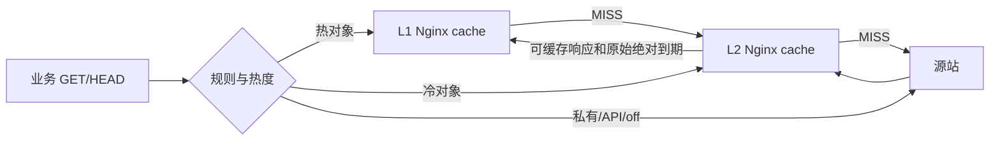

# Tier：原生 L1/L2 分层缓存

版本 0.1.1。`ngx_http_scdn_tier_module.so` 是纯 C 模块。它接替 Lua 的访问计数选层，并建立 L1 → 本机 L2 → 源站的读取链；L2 保留已缓存的持久副本，L1 按热度填充。缓存写入、锁、Vary、Range 和回收由 Nginx 原生 proxy_cache 实施，模块不直接复制/删除其私有缓存文件，也不运行 Lua、shell find/cp 或停机落盘脚本。

0.1.1 修复分层条件校验的 304→502、未携带新鲜度头的 304 无法有效续期、L2 校验器被模板覆盖、路由 L2 限额丢失及保留头透传；默认键改为长度编码，L2 的 STALE/UPDATING/REVALIDATED 状态透传到业务诊断。升级步骤见下文。

## 与原 Lua 的对应

| 原逻辑 | 原生实现 |
| --- | --- |
| `tier.lua` 的共享字典计数、达到阈值选 L1 | 有界共享计数与 `scdn_tier_heat`；或接收 Edge 已求值的 l1/l2/off |
| 原注释称“滑窗”，实际 incr 初始化 TTL 后不续期 | 明确采用从首个计数起的固定窗口，默认 3 次/90 分钟；不冒称严格滑窗 |
| L1/L2 独立选择，L1 miss 可能直接回源 | L1 miss 经过本机 Unix Socket 读取 L2，L2 miss 才回源 |
| `flush_l1_to_l2.lua` 扫目录，只复制 L2 不存在的文件 | 正常填充先由 L2 缓存，再把响应送至 L1；维护时不需要补拷贝活动缓存文件 |
| 冷热点回退 | 计数窗口到期后选择 L2，其已有副本继续可用；L1 空间由 Nginx inactive/max_size 管理 |



L1 HIT 没有层间代理；冷请求和 L1 MISS 增加一次本机 Unix Socket 代理。模块不承诺所有负载下都低于单层开销。L1 可以放在 tmpfs，L2 放持久存储；存储介质、容量、inactive、min_free、keys_zone 都由 proxy_cache_path 配置。

## 指令与变量

| 指令 | 上下文 | 语义 |
| --- | --- | --- |
| `scdn_tier_zone NAME SIZE` | http | 共享热度/实例令牌/计数；通常 1m，最多 16m；固定 4096 热度槽 |
| `scdn_tier_socket /absolute/l2.sock` | http | 本机 L2 Socket，必须与 backend listener 一致；目录权限由部署限制 |
| `scdn_tier_heat HITS WINDOW` | http | 默认 3/90m；1～1000000 次、100ms～24h |
| `scdn_tier_front SELECTOR ORIGIN` | location | selector 为 l1/l2/auto/off，可用复杂变量；origin 是真实源站 URL/命名池 |
| `scdn_tier_identity HOST SNI SCOPE KEY RESOURCE` | location | 固定本次请求的源站身份、缓存 scope、完整基础 key 和逻辑清理资源，可用变量 |
| `scdn_tier_bypass VALUE` | front location | 非空且非 0 时直达源站；API 接入填 `$scdn_api_skip_cache` |
| `scdn_tier_backend` | location | 接收本实例鉴权的 Unix 请求，作为 L2 代理入口 |
| `scdn_tier_max_size L1 L2` | location | 新对象存储上限，默认 512m/32g；前端 L2 限额传至 backend，与 backend 本地上限取较小值；未知 Content-Length 保守不存储 |
| `scdn_tier_status` | location | Unix 本机 GET/HEAD 计数端点，无令牌/URL/缓存键输出 |

`$scdn_tier_upstream` 用于 front proxy_pass，`$scdn_tier_cache` 返回实际写入的 l1/l2/off；`$scdn_tier_origin`、`$scdn_tier_host`、`$scdn_tier_sni` 用于 backend 回源；scope/key/resource 用于缓存及 Purge。`$scdn_tier_no_store` 必须接入 proxy_no_cache，`$scdn_tier_validate` 接入 backend proxy_cache_bypass，让上层条件校验真正到达源站。

`$scdn_tier_cache_key` 以长度编码 scope/key，供不接 Purge 的两端作为同一缓存键。`$scdn_tier_wire_l2_limit` 是前端发送的受信 L2 字节上限。backend 的 `$scdn_tier_if_none_match` / `$scdn_tier_if_modified_since` 在上层校验时传递上层校验器；普通 L2 过期时使用 Nginx 为 L2 对象保存的 ETag/Last-Modified。不要换成无条件的 `$http_if_none_match`，否则 L2 自身的条件校验会失效。

热度键包含 scope 和完整基础 key，可把 Host/scheme/配置 revision/查询串纳入隔离。固定槽冲突重置热度，只影响缓存选择提示，不影响内容键、授权或正确性；它不用于限速/计费。每请求只计数一次。进程重启清空热度但不清空 Nginx 的 L2 文件。

## 配置接入

[完整配置](examples/nginx.conf)依赖 [front.conf](examples/front.conf)和 [backend.conf](examples/backend.conf)。模块可与 Purge 一起独立加载，也能接入 Config/API/Edge。完整运行时动态加载顺序建议 Config → Ban → Tier → API → Edge → Purge → Sync；静态编入时不写 load_module。实际 C 接口依赖仍是 Config/API/Edge，Tier 本身不依赖 Lua。

Edge 的 web 命名代理 location 可配置：

```nginx
scdn_tier_front $scdn_edge_cache $scdn_edge_upstream;
scdn_tier_identity $scdn_edge_origin_host $scdn_edge_origin_sni
    "$scheme|$host" "$scdn_edge_revision|$scheme|$host|$request_uri" $request_uri;
scdn_tier_bypass $scdn_api_skip_cache;
include /etc/scdn-tier/front.conf;
```

API/AI、SSE、gRPC、WebSocket 继续使用各自直达源站的 profile，不把长流塞入 L1/L2。即使未接入 API，Tier 也会绕过非 GET/HEAD、有正文、Authorization/Proxy-Authorization/Cookie/X-API-Key/Api-Key/Upgrade 请求，以及 Cache-Control/Pragma 禁用缓存请求。原生 proxy 的 Set-Cookie/Cache-Control/Vary 规则继续适用，不设置强制忽略私有头。

backend 只接受真实 Unix transport，并验证随机实例令牌；网络请求即使伪造头也不能访问。front 删除客户端的整个 X-Tier-* 命名空间后生成本次协议字段，backend 验证并保存字段后从请求列表移除，回源不保留未知内部头。响应中的 X-Tier-* 同样由模块清除，backend 仅生成自己的可信元数据。它们只承载本次已确定的路由/缓存身份，不重新在另一 Worker 解析可能已改变的站点配置。必须完整使用模板，不能遗漏令牌/字段覆盖或剥离，不能让业务客户端自行设置 origin。Socket 父目录保持受限，同服务 UID 属于受信边界。

较长缓存键需要 backend `large_client_header_buffers 4 16k;` 和模板中的 32k proxy buffers。基础 key 至多 8192 字节，其他字段最多 4096；Purge 的独立输入限制仍适用。默认 `$scdn_tier_cache_key` 不会把 `scope=a|b,key=c` 与 `scope=a,key=b|c` 拼成同一对象；启用清理时，两端改用 Purge 的版本键。

## 与 Purge、源站校验和预热配合

在 front/backend **两端**把模板的 proxy_cache_key 替换为：

```nginx
scdn_purge_key $scdn_tier_scope $scdn_tier_key $scdn_tier_resource;
proxy_cache_key $scdn_purge_key;
# Optional, on each tier:
scdn_purge_revalidate 30s;
scdn_purge_stale updating=30s error=5m;
```

两层相同 scope/resource 使精确、模式、整站和整机 epoch 同时生效，清理不扫描任何缓存目录。在途旧请求仍使用其已确定的版本。强制缓存的条件校验沿 X-Tier-Validate 经 L2 回源，不会把 L2 的旧 HIT 当作源站已确认未变化。

backend 通过内部 X-Tier-Expires 为可缓存响应提供原始**绝对到期**，前端在 proxy_no_cache 求值阶段约束入库期限，L1 晋升不会重新起算一整个 max-age。该字段不会被 Nginx 当成持久 X-Accel-Expires 在后续 304 中重新解释，所以源站确认未修改后可以正常续期并再次 HIT。源站新增的 304 缓存策略仍被尊重；配合 Purge 时，304 改为 private/no-store、设置 Cookie 或禁止缓存会拒绝续期并失效旧对象。

过期/stale 响应不能被当作新鲜对象长期写入 L1；两层的 stale 窗口仍由各自原生/Purge 配置决定。两个模板默认启用原生 proxy_cache_revalidate；按访问间隔后台检测和有界过时复用还需两端配置上述 Purge 指令。只存储完整可缓存的 200；未知长度、截断正文、错误响应和重定向不作为新对象入库。单文件限额是新写入的准入，不是删除既有大文件。Range 沿用 Nginx 规则，源站需要声明 Accept-Ranges，或部署明确启用 proxy_force_ranges。

Sync 缓存预热走同一业务入口，能填充相应层。热对象 L1 HIT 时无需额外写 L2，正常新对象已经经由 L2；迁移前遗留的“只有 L1”的旧文件不自动变成 L2 副本。升级应使用新 zone/path 冷启动或提前在 L2 完成受控预热，再停用旧 Lua tier/维护 flush 调用，不能一边使用旧独立写路径一边假定已成为完整层级缓存。

## 诊断、验证与边界

业务响应 `X-Cache-Layer` 返回实际来源 l1/l2/origin/off，`X-Cache` 表示所用缓存层的 HIT/STALE/UPDATING/REVALIDATED 等状态；L2 过时复用不会冒报普通 HIT。Edge 的 X-Cache-Policy/Revision 仍表示配置选择和请求版本。Tier 独立生成 X-Cache/X-Cache-Layer，Edge 的 cache_headers off 不关闭 Tier 诊断。内部 X-Tier-Source/Cache/Store/Expires 不向客户端输出。不要额外 add_header 同名字段。

状态接口的 l1_hits/l2_hits/origin_reads/bypasses 按前端响应来源计数；其中 origin_reads 是直接返回源站正文的计数，不是全部上游网络请求数，304 校验可能归于对应缓存层。精确回源流量应结合源站或 backend 的访问指标统计，并避免记录内部令牌。

`native-tier/tests/integration.py` 验证选层、L2 读取晋升、大小准入、私有响应、Vary/查询串、Purge、源站再验证、并发锁、L1 丢失重启和信息边界；`native-tier/tests/boundaries.py` 覆盖 ETag/Last-Modified/无校验器、304 续期及私有化、HEAD/Range、有限 stale、并发后台更新和协议隔离；`native-tier/tests/coexist.py` 同时启用六个业务模块并运行真实 API/AI/SSE/WebSocket/gRPC 代理检查。七模块统一构建中的 Ban 有独立执行测试。

`native-sync/tests/cache_tasks.py --tier` 通过真实 mTLS Master/Node 执行两层刷新、HTTP/HTTPS 预热、各模式清理、任务恢复，以及丢失 L1 后使用预热的持久 L2。以上测试接受 `--prefix`、`--static` 和 `--report`。缓存管理仍由 Nginx 完成，不保证任意旧二进制 ABI、不同模块过滤顺序或未经验证的代理模板均兼容；真实 tmpfs/SSD 压力、PPS/QPS、磁盘掉电和容量需单独测量。

## 从 0.1.0 升级

模块和 front/backend 两份模板必须一起升级，新增受信 L2 上限和到期元数据不可遗漏。采用独立实例/Unix Socket 验证并切换，避免旧、新 Worker 共用同一后端 Socket 混用协议。默认缓存键格式变化会产生冷缓存；使用新 cache zone/path，或在新链路完成受控预热，再按 Nginx 回收流程处理旧目录。接入 Purge 时继续使用同一逻辑 scope/key/resource，但也应隔离旧的绝对到期元数据，不能把旧文件直接复制成新格式。站点策略后续仍可通过 Config 热更新；模块程序和固定 Nginx 模板的升级不属于无重建 Worker 的配置更新。

合并审查补充：凭据字段即使重复出现也始终绕过缓存；重复 Cache-Control/Pragma 保守绕过，不能因严格唯一字段查找失败而退回共享缓存。回归会先填充匿名公共对象，再验证不同凭据请求均真实回源且不会相互复用。

当前统一构建包含原生 [Ban](../native-ban/RUNTIME.zh-CN.md)。一起编译时 Ban 必须先于 API/Edge 动态加载；未配置 scdn_ban on 时不启用封禁。其 Agent/eBPF 和全节点快照是独立运行路径，Sync 桥接需显式 scdn_sync_ban_agent。
